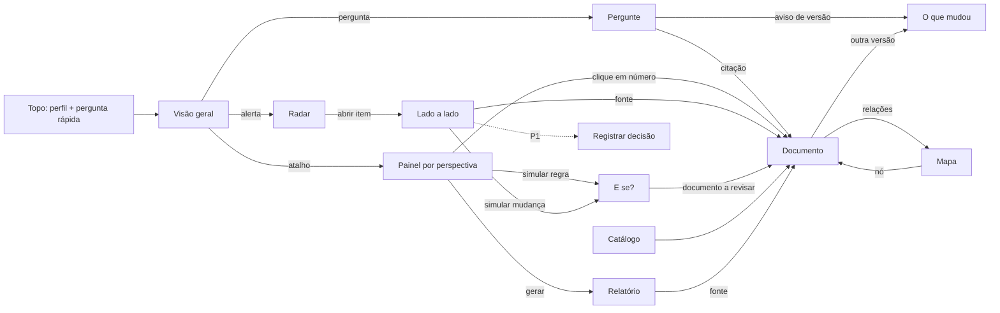

# Levantamento de requisitos e fluxo de telas — Frontend (HACKA/TS 2026 · Desafio 2 · Clankers)

Base: `docs/PRD.md` (recorte do Lead, 12/11 10h), `docs/CONTRATO-API.md` + adendos v0.1/v0.2, `docs/IDEIA.md`, critérios do regulamento (item 10). Status: **rascunho para validação da equipe**; itens marcados ⚖️ dependem de decisão.

## 1. Perfis de usuário
| Perfil | O que quer resolver primeiro | Linguagem e formato | Telas mais usadas |
|---|---|---|---|
| Empregado | Até quando peço minhas férias? O que preciso enviar? | Linguagem simples, passo a passo, datas concretas | Pergunte, Documento |
| Gestor | O que preciso aprovar, até quando, e o que acontece se eu não decidir? | Prazos, responsabilidades, checklist | Pergunte, Painel Pessoas, Radar |
| Diretoria | Risco, valor, decisão e quem aprova | Resumo executivo de 3 linhas, números destacados | Visão geral, Relatório, Radar |
| Financeiro (GFI) | Valores, multas, datas de pagamento, alçadas | Números com fonte, tabelas e gráficos | Painel Financeiro, E se? |
| Jurídico/Contratos (GCO/GJU) | Cláusula, vigência, conflito entre normas, versão válida | Texto original + resumo, comparação de versões | Painel Jurídico, Radar, O que mudou, Mapa |
| RH (GGC) | Testar mudança de regra antes de publicar | Simulação, impacto, documentos a revisar | E se?, Radar, Painel Pessoas |

Regra de UX Writing/Legal Design: o perfil muda a **forma e a ordem** da resposta (resumo → detalhe → texto original), **nunca o conteúdo nem as fontes**.

## 2. Requisitos funcionais
| ID | Requisito | Prior. | Tela | API |
|---|---|---|---|---|
| RF01 | Selecionar o perfil e lembrar a escolha | P0 | Topo | — |
| RF02 | Visão geral com destaques, alertas do radar e atalhos por perspectiva | P0 | Visão geral | /api/saude, /api/radar, /api/perspectivas |
| RF03 | Perguntar em linguagem natural, com perguntas sugeridas por perfil | P0 | Pergunte | POST /api/perguntar |
| RF04 | Toda resposta mostra citações código · versão · seção clicáveis | P0 | Pergunte, Painéis, Relatório | — |
| RF05 | Estado "Não consta nas fontes" claro, com sugestão do que perguntar | P0 | Pergunte | consta=false |
| RF06 | Aviso quando a fonte é versão substituída, mostrando a vigente | P0 | Todas com fonte | avisos |
| RF07 | Painel por perspectiva: destaques, gráfico de valores, linha do tempo, matriz de responsáveis, riscos | P0 | Painel | /api/perspectivas/{id} |
| RF08 | Qualquer número/prazo/item abre o trecho de origem | P0 | Painel → Documento | fonte |
| RF09 | Radar de contradições por severidade, com filtro por perspectiva e comparação lado a lado | P0 | Radar | /api/radar |
| RF10 | Selo "citado, mas não está no acervo" (ex.: NG_012) | P0 | Radar, Financeiro | referencia_ausente |
| RF11 | E se?: escolher regra, alterar valor, ver linha do tempo antes/depois, conflitos e documentos a revisar | P0 | E se? | /api/regras, POST /api/simular |
| RF12 | Aviso fixo "Simulação hipotética: não altera os documentos" | P0 | E se? | aviso |
| RF13 | Catálogo com filtros (assunto, tipo, vigente/substituído) e busca | P0 | Catálogo | /api/documentos |
| RF14 | Leitor com cabeçalho, seções, âncora e destaque da seção citada, troca de versão | P0 | Documento | /api/documentos/{codigo} |
| RF15 | O que mudou: diff por seção entre versões + resumo | P0 | O que mudou | /api/comparar |
| RF16 | Mapa do acervo: grafo de relações, substituídos tracejados, nós ausentes | P0 | Mapa | /api/grafo |
| RF17 | Relatório executivo imprimível com fontes | P0 | Relatório | /api/relatorio |
| RF18 | Decodificar código de documento | P0 | Catálogo | /api/codigo/{codigo} |
| RF19 | Registrar decisão sobre item do radar | P1 ⚖️ | Radar → modal | POST /api/decisoes |
| RF20 | Resumo da conversa (decisões, pendências, citações) | P1 ⚖️ | Pergunte | POST /api/resumo-conversa |
| RF21 | Upload de documento com status de ingestão | P1 ⚖️ | Catálogo | POST /api/documentos |
| RF22 | Indicador de IA (Bedrock ativo ou modo extrativo) | P1 | Topo/rodapé | /api/saude.ia |

## 3. Requisitos não funcionais
- RNF01 Confiança: nenhum número sem fonte.
- RNF02 Acessibilidade (critério 10.4): contraste AA, teclado, foco visível, tabela equivalente a cada gráfico, textos alternativos.
- RNF03 Linguagem: português simples; siglas explicadas; datas dd/mm/aaaa.
- RNF04 Resiliência: API fora → mensagem + mock, a demo não quebra.
- RNF05 Desempenho: retorno visual < 2 s; carregamento em toda chamada.
- RNF06 Responsivo: desktop para a demo, legível em tablet.
- RNF07 Não estático: todas as telas consomem dados (regulamento 8.5).

## 4. Inventário de telas
| # | Tela | Objetivo | Estados |
|---|---|---|---|
| T0 | Topo global | Perfil, pergunta rápida, navegação | — |
| T1 | Visão geral | Em 10 s: alertas, números-chave, por onde começar | carregando, vazio, erro |
| T2 | Pergunte ao acervo | Resposta confiável com fontes | resposta, não consta, aviso de versão, erro |
| T3 | Painel por perspectiva | Análise por departamento | carregando, sem dados |
| T4 | Radar de contradições | Conflitos e referências ausentes | com itens, sem itens |
| T5 | Comparação lado a lado | Ver as duas fontes e decidir | — |
| T6 | E se? | Simular regra | atual, simulado, inválido, conflito |
| T7 | Catálogo | Encontrar documentos | lista, sem resultado |
| T8 | Documento | Ler a fonte com destaque | vigente, substituído, seção citada |
| T9 | O que mudou | Diferenças entre versões | sem versão anterior |
| T10 | Mapa do acervo | Relações entre documentos | nó ausente |
| T11 | Relatório executivo | Levar para a reunião | prévia, impressão |
| M1 | Registrar decisão ⚖️ | Fechar o ciclo | sucesso, erro |

## 5. Fluxo de navegação

## 6. Jornadas por perfil
- Empregado: perfil → T2 "Até quando peço férias que começam em 05/05/2027?" → "até 21/03/2027" com passos → citação → T8 PX_1111-001 Anexo D.
- Gestor: T1 → T3 Pessoas → linha do tempo D-45…D-3 → "o que eu aprovo" (7 dias) → T8 seção 8.3.
- Diretoria: T1 → alerta → T5 lado a lado → T11 relatório Jurídico/Contratos → imprimir.
- Financeiro: T3 Financeiro → R$ 18.250 e alçada de diretor + selo NG_012 ausente → multa R$ 912,50 → T8 CTR_2026-012 Apêndice B.
- RH: T4 (30 → 45 dias) → T5 → simular → T6 45 → 30 → conflito com D-35 + documentos a revisar → T8.

## 7. Demo (≤ 2 min) nas telas
1. T4/T5 Radar: 45 dias vigente v3 × v2 e FM v1 diziam 30.
2. T6 E se?: 45 → 30, a linha do tempo quebra no D-35 (§4.5).
3. T3 Financeiro: R$ 18.250, alçada de diretor, NG_012 ausente, multa → Apêndice B.
4. T2: "Uma mesma pessoa pode elaborar, revisar e aprovar?" → não consta.
5. T11: relatório Jurídico/Contratos com fontes clicáveis.

## 8. Issues do frontend
- FE #3 (em andamento): T3, T9, T10, T11.
- FE #2: integração real + decodificador (RF18).
- FE #5: T4, T5, T6.
- Sem issue ainda: T1 Visão geral, RF01 perfil global + respostas em camadas, RF19–RF22 (P1).

## 9. Decisões pendentes ⚖️
1. Slack na demo: plano B (recorte do Lead) ou cena principal (ideia original)?
2. E se?: 8% → 10% (ideia) × férias 45 → 30 (escolhido: o acervo não tem limite de reajuste em %).
3. Upload e documentos fictícios da equipe: fora do P0 até a organização autorizar.
4. Registro de decisão (passo 6 da demo original): P1 ou P0?
