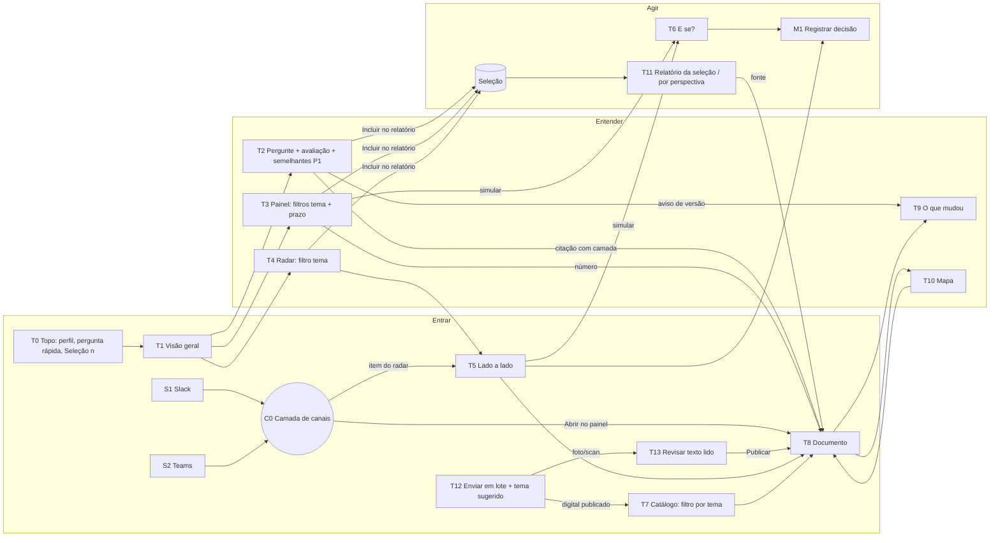

# Fluxo de telas v2: Clankers · Desafio 2 (PROPOSTA, Planner, 12/11/2026)

**Status:** proposta, **com o QA-FLUXO-v2 (Bússola) aplicado**: o histórico das mudanças está em `REQUISITOS-v3.md` §0. Evolui `FLUXO-DE-TELAS.md` (v1) com as decisões humanas de 12/11 e com as 8 funcionalidades esperadas pela organização (`docs/FUNCIONALIDADES-ESPERADAS.md`). Só vale depois de aprovada pela equipe. Os requisitos novos ou alterados estão em `REQUISITOS-v3.md` (delta da v2).

**Decisões humanas já válidas (12/11):**
- **Slack e Teams no MVP.** O Teams usa o Microsoft 365 Agents SDK (Python) e é testado no Microsoft 365 Agents Playground, sem tenant. Os dois canais consomem a mesma API: a mesma pergunta gera a mesma resposta, com a mesma fonte e o mesmo link para o painel. A publicação corporativa na BBTS fica no plano de 6 meses.
- **Upload (decisão 5) e digitalização física (decisão 6) no MVP.**
- Com isso, a ⚖️1 está resolvida: RF27 e RF28 passam a ser P0 firmes.

**Já implementado:** T10 Mapa e T11 Relatório (FE PR #6, `qa:aprovado`). Eles não são P1 e saem da ordem de corte.

**Convenções mantidas da v1:**
- Textos de interface seguem o guia de voz e tom e as boas práticas de linguagem simples (RNF04/RNF15).
- Citação no formato RNF14, agora **com a camada** (RF42).
- Data concreta primeiro, D-n entre parênteses.
- Um destaque por tela.
- Toda tela termina com a próxima ação (RF32).
- **[novo]** = fora do contrato atual.

**Inventário:** 15 telas web (T0–T13 + M1) e 2 canais (S1 Slack, S2 Teams) sobre uma camada comum de canais (C0).

## 1. Fluxo geral: entrar → entender → agir


**Rotas profundas** (v1, com novos parâmetros):

| Rota | Tela | Observação |
|---|---|---|
| `/` | T1 | |
| `/perguntar?q=` | T2 | |
| `/painel/:perspectiva?tema=&prazo=` | T3 | filtros no FE (tema + prazo) |
| `/radar?tema=` | T4 | filtro de tema no FE (sem prazo: QA C2) |
| `/radar?item=:id` | T5 | |
| `/e-se?regra=&valor=` | T6 | |
| `/catalogo?tema=` | T7 | filtro novo |
| `/documento/:codigo?versao=#secao-:id` | T8 | |
| `/comparar?codigo=&de=&para=` | T9 | |
| `/mapa` | T10 | |
| `/relatorio?perspectiva=` | T11 | por perspectiva |
| `/relatorio?selecao=1` | T11 | da seleção |
| `/enviar` | T12 | |
| `/enviar/lote/:id` | T12 | |
| `/enviar/:id` | T13 | |

## 2. Componentes e estados comuns
Os estados da v1 continuam válidos: carregando, vazio, erro de API, fixture, não consta, versão substituída, simulação, digitalização e ausente. Muda ou entra:

| Componente | Comportamento | Texto de interface |
|---|---|---|
| **Chip de citação com camada** (RF42) | `CÓDIGO · vVERSÃO · Seção` + selo de camada com a sigla e o grupo do catálogo. Se o documento é subordinado, mostra o **pai direto** pelo `Vinculado a` (a cadeia completa fica no T8). Nos canais, a forma é curta (`PX · Normativo`) | `PX_1111-001 · v1.0.0 · Anexo D` · **PX Procedimento · Normativo · subordinado à NG_111** · `FL_1111-001` → **FL Fluxo · Apoio · subordinado à PX_1111-001** |
| **Versão substituída × divergência** (funcionalidade 7) | Dois casos com textos diferentes. **Versão substituída:** vale a vigente, e as duas fontes aparecem. **Divergência entre fontes vigentes:** as duas aparecem, sem escolher; se o próprio acervo declarar precedência, ela é citada. No ACME, os itens do radar são do 1º caso ou de norma ausente (Matriz, item 7) | Substituída: "Esta regra mudou. Vale a versão vigente 3.0.0." · Divergência: "As fontes divergem. Mostramos as duas, sem escolher." + quando houver: "O PX_1111-001 · v1.0.0 · 2.2 diz que, em divergência, prevalece a NG_111." |
| **Filtros tema + prazo** (RF37, no FE) | **Tema** em T3, T4, T7 e T10: assunto do acervo (Férias, Inovação, Locação + temas de documentos enviados) e série do catálogo. **Prazo só no T3:** "Próximos 30 dias", "Próximos 90 dias", "Até <data>", "Vencidos", contados a partir da data de referência (RF31). Os filtros aparecem como chips removíveis | Vazio: "Nenhum item neste filtro. Remova um filtro ou amplie o prazo." + [Limpar filtros] |
| **Avaliar resposta** (RF39) | "Esta resposta foi útil?" [Sim] [Não]; no "Não", motivo opcional: Fonte errada, Faltou informação, Difícil de entender, Outro (texto até 200 caracteres). Cada clique gera 1 registro (num canal compartilhado, várias pessoas avaliam a mesma resposta). O resumo aparece no T1 | Confirmação: "Obrigado. Sua avaliação ajuda a melhorar as respostas." · Erro: "Não conseguimos registrar agora. Tente de novo em alguns segundos." |
| **Incluir no relatório** (RF41) | Caixa em cada resposta, cartão do painel e item do radar; contador "Seleção (n)" no T0; a seleção fica guardada neste navegador. Ao abrir o T11, o FE confere cada fonte com `GET /api/documentos/{codigo}` | "Incluído na seleção (3 itens)." · [Gerar relatório da seleção] |
| **Análises semelhantes** (RF40, P1) | Até 3 perguntas anteriores parecidas **do mesmo perfil**, com data e avaliação; "Reaproveitar" abre a resposta anterior e confere a fonte | "Já perguntaram algo parecido:" · Se a fonte mudou: "A fonte desta resposta mudou desde 12/11/2026. Veja a versão vigente." |

## 3. C0: camada comum de canais (descrita uma vez; vale para S1 e S2)
- **Princípio:** o canal é só apresentação. Uma única função de formatação no backend (`canais/cartao.py`) transforma a resposta da API num **cartão neutro**. Dois adaptadores o convertem: o Block Kit (Slack) e o Adaptive Card (Teams).
- **Paridade:** a mesma pergunta, no mesmo perfil, gera o mesmo texto, as mesmas citações e o mesmo link nos dois canais (RNF17).

| Parte do cartão | Conteúdo | Regra |
|---|---|---|
| 1. Conclusão | 1 frase, conclusão primeiro | ≤ 25 palavras (RNF04) |
| 2. Citações | Até 3 chips com camada **curta** (`PX · Normativo`, RF42) e trecho ≤ 200 caracteres | Formato RNF14 |
| 3. Avisos | Versão substituída, divergência, documento citado ausente | Ícone + texto |
| 4. Próxima ação | 1 linha (RF32) | — |
| 5. Botões | "Abrir no painel" (abre o **T2 com a pergunta**; cada citação abre o **T8 na seção**) · "Útil" / "Não útil" (RF39) · "Ver resposta normal" (quando a mensagem foi roteada ao radar, RF28) | O link usa `PAINEL_URL` |

| Estado | Texto (igual nos dois canais) |
|---|---|
| Respondendo | "Consultando o acervo…" (confirmação em < 3 s; depois a resposta substitui ou segue a mensagem) |
| Resposta | Cartão completo |
| Não consta | "O acervo não trata disso." + "Reformule ou pergunte: <sugestão>." + "Abrir no painel" (T2 com a pergunta) |
| Radar | 1 bloco por item da lista fechada (RF17), com fontes e o link para o T5 |
| Avaliação registrada | "Obrigado. Sua avaliação ajuda a melhorar as respostas." |
| API fora | "Não consegui consultar o acervo agora. Tente de novo em alguns segundos ou use o painel: <PAINEL_URL>." O bot continua vivo |
| Canal fora | A API e o painel continuam; a mesma pergunta funciona no T2 |

### S1 Slack
- Bolt para Python, Socket Mode, workspace gratuito.
- Comandos `/acervo <pergunta>`, `/acervo radar [tema]` e `/acervo ajuda`.
- Variáveis `SLACK_BOT_TOKEN`, `SLACK_APP_TOKEN`, `API_URL`, `PAINEL_URL`.
- RF27, RF28, RF34, RF39.

### S2 Teams
- Microsoft 365 Agents SDK (Python), testado no **Microsoft 365 Agents Playground**, local e sem tenant.
- Mensagem direta ao agente: `acervo <pergunta>`, `acervo radar [tema]` ou só a pergunta. Resposta em Adaptive Card com as mesmas 5 partes.
- **Timebox: 1 h para rodar o "eco" no Agents Playground. Se não rodar, o Teams vira P1 e o pitch mostra o mesmo cartão (Adaptive Card gerado pela C0) como prova de paridade, com o Slack ao vivo** (RF33, QA C3).
- No Playground, roda sem credencial corporativa. O registro de app, as credenciais do Azure Bot e a publicação no tenant da BBTS ficam no plano de 6 meses (só nomes de variável em `.env.example`).
- RF33, RF34, RF39.
```
Teams (Agents Playground)            Slack
acervo Até quando peço férias        /acervo Até quando peço férias
que começam em 05/05/2027?           que começam em 05/05/2027?
┌ Peça até 21/03/2027 (D-45).      ┐  ┌ (mesmo cartão em Block Kit) ┐
│ NG_111 · v3.0.0 · Anexo C        │
│  NG · Normativo                  │
│ Próxima ação: pedir no Portal    │
│ [Abrir no painel] [Útil] [Não útil]│
└──────────────────────────────────┘
```

## 4. Telas
Telas sem mudança de comportamento em relação à v1 estão resumidas e apontam para ela. As mudanças vêm marcadas com **Δ**.

### T0 Topo global
- **Δ:** contador "Seleção (n)" com o atalho "Gerar relatório da seleção" (RF41).
- O resto segue a v1: perfil, pergunta rápida, modo de IA e data de referência.
```
[ACME · Acervo] Perfil [Gestor ▾] [ Pergunte… ][Perguntar]   Seleção (3) ▸
```

### T1 Visão geral
- Igual à v1 (RF08, RF31, RF32).
- **Δ:** cartões por tema além de por perspectiva ("Férias · 2 pontos no radar"), que levam ao T3/T4 já filtrados (`?tema=`).
- **Δ (RF39):** linha "Respostas avaliadas: n · úteis: n" (`GET /api/avaliacoes/resumo` **[novo]**), que fecha o ciclo da avaliação.

### T2 Pergunte ao acervo
- **Objetivo:** resposta confiável com fonte, avaliável e reaproveitável. **Perfis:** todos.
- **Componentes:** campo; sugestões do perfil; resposta em camadas; chips de citação **com camada** (Δ); avisos de versão e divergência; próxima ação; **Δ** avaliar resposta; **Δ** "Incluir no relatório"; **Δ (P1)** "Já perguntaram algo parecido" (até 3) com "Reaproveitar"; P1 Resumo da conversa.
- **Dados:**
  - `POST /api/perguntar` → + `resposta_id` **[novo]**, `citacoes[].camada` **[novo]**;
  - `POST /api/avaliacoes` **[novo]**;
  - P1 `GET /api/analises/semelhantes?q=&perfil=` **[novo]**.
- **Estados:**
  - carregando;
  - resposta;
  - não consta (também avaliável);
  - versão substituída;
  - divergência;
  - erro;
  - avaliação enviada;
  - semelhantes vazio (não mostra o bloco);
  - reaproveitada com fonte alterada.
- **Navegação:** entra pelo T0, T1, rotas ou pelo "Abrir no painel" dos canais. Sai para o T8, o T9 ou o T11 (seleção).
- **RF/RNF:** RF02–RF06, RF32, RF39, RF40 (P1), RF41, RF42, RNF16.
```
[ Até quando peço férias que começam em 05/05/2027?   ][Perguntar]
 Já perguntaram algo parecido (P1): • "Prazo para pedir férias" · 12/11 · útil  [Reaproveitar]
┌ Peça no Portal Raiz até 21/03/2027 (D-45), com o FM_1111-001.        ┐
│ NG_111 · v3.0.0 · Anexo C   [NG Norma Geral · Normativo]             │
│ PX_1111-001 · v1.0.0 · Anexo D [PX Procedimento · subordinado à NG_111]│
│ Próxima ação: pedir no Portal Raiz até 21/03/2027.                   │
│ [ ] Incluir no relatório     Esta resposta foi útil? [Sim] [Não]     │
└──────────────────────────────────────────────────────────────────────┘
```

### T3 Painel por perspectiva
- Base da v1: abas, destaques, gráficos com tabela, linha do tempo, responsáveis, riscos, selo de ausente.
- **Δ filtros (no FE):** tema (assunto/série) e prazo (janela a partir da data de referência), com chips removíveis e estado "Nenhum item neste filtro…".
- **Δ "Obrigações":** a matriz de responsáveis passa a se chamar "Responsáveis e obrigações" (funcionalidade 3).
- **Δ** "Incluir no relatório" em cada cartão e item.
- **Δ** chips com camada.
- **Dados:** `/api/perspectivas/{id}` (sem parâmetro novo; o FE filtra pelos campos `tema` e `data` dos itens; ver C17).
- **Estados:** + filtro vazio.
- **RF/RNF:** RF09 (alterado), RF10, RF19, RF37, RF41, RF42.
```
[Jurídico] [Financeiro*] [Pessoas] [Gestão]   Tema [Locação ×]  Prazo [Próximos 30 dias ×]
 Próximos prazos (a partir de 12/11/2026):
  [ ] 25/11/2026 vistoria · CTR_2026-012 · v1.0.0 · Apêndice C [CTR Contrato · Instrumento]
  [ ] 30/11/2026 início da vigência e entrega · Cláusula Segunda
 Responsáveis e obrigações: GOC fiscal técnico — atesta em 5 dias úteis (Cláusula Nona) …
 [Incluir selecionados no relatório]
```

### T4 Radar de contradições
- Base da v1: lista fechada de 3 itens, ausência agrupada por norma, próxima ação.
- **Δ filtro de tema** (no FE). **Sem filtro de prazo:** os itens do radar não são prazos (QA C2).
- **Δ** "Incluir no relatório".
- **Δ** chips com camada e os dois textos distintos (§2): "versão substituída → vale a vigente" × "divergência → mostramos as duas, sem escolher".
- **Dados:** `/api/radar` (sem parâmetro novo; `tema` por item, C17).
- **Estados:** + "Nenhum item neste filtro. Remova um filtro ou amplie o prazo."
- **RF/RNF:** RF17 (alterado), RF37, RF41, RF42.
```
 Tema [Férias ×]
 ⚠ Esta regra mudou. Vale a versão vigente 3.0.0: v2.0.0 dizia 30 dias, v3.0.0 exige 45  [NG Norma Geral · Normativo]
   [ ] Incluir no relatório     [Comparar lado a lado →]
```

### T5 Lado a lado · T6 E se? · M1 Registrar decisão
- Comportamento da v1.
- **Δ** chips com camada.
- **Δ** T5 e T6 com "Incluir no relatório" (o resultado da simulação entra marcado "Simulação hipotética").

### T7 Catálogo
- Base da v1.
- **Δ** filtro e agrupamento por tema (assunto + série do catálogo, ex.: "Série 1 · Gente e Cultura") e a coluna "Camada".
- **Δ** documentos enviados mostram o tema confirmado e quem confirmou.

### T8 Documento
- Base da v1.
- **Δ** cabeçalho com a camada e a cadeia completa de subordinação pelo `Vinculado a` ("FL_1111-001 → PX_1111-001 → NG_111").
- **Δ (P1, funcionalidade 4)** documento do tipo FL renderiza o fluxograma, com cada etapa clicável até a seção da PX/NG correspondente.

### T9 O que mudou
- Igual à v1 (inclui RG_1100 pelo Anexo K).

### T10 Mapa do acervo: **implementado (FE PR #6)**, P0
- Grafo por tipo, substituídos tracejados, nós ausentes pela regra do radar, lista equivalente.
- **Δ (cortável, ainda não implementado):** filtro por tema (no FE) e legenda por camada (Normativo, Apoio, Instrumento, Programa…).
- **RF/RNF:** RF14 (promovido), RF37, RF42.

### T11 Relatório executivo: **implementado (FE PR #6)**, P0
- Por perspectiva, como na v1.
- **Δ (ainda não implementado) modo "Relatório da seleção" (funcionalidade 6):** recebe os itens marcados no T2, T3, T4, T5 e T6. A pessoa pode reordenar, retirar, dar título e imprimir. Cada item mantém a fonte com camada; a simulação vem marcada como hipotética. P1: síntese de abertura pelo Bedrock, só com os itens selecionados.
- **Dados:** os itens já trazem `fonte`; o FE compõe o relatório e **confere cada fonte com `GET /api/documentos/{codigo}`** (já existe). Se a versão vigente for outra, o item recebe "Esta fonte mudou desde que foi selecionada.". P1: `POST /api/relatorio` com `itens[]` para a síntese.
- **Estados:** seleção vazia ("Nenhum item selecionado. Marque 'Incluir no relatório' numa resposta, painel ou radar."), prévia, impressão, item com fonte alterada ("Esta fonte mudou desde que foi selecionada.").
- **RF/RNF:** RF15 (promovido), RF41.
```
 Relatório da seleção · 12/11/2026      Título [ Férias: o que mudou ]   [Imprimir]
 1. ↕ Antecedência 45 dias · NG_111 · v3.0.0 · 4.3.1 [NG · Normativo]     [Retirar]
 2. ↕ Pedido até 21/03/2027 · NG_111 · v3.0.0 · Anexo C                   [Retirar]
 3. ↕ Simulação hipotética: 30 dias quebra o aviso D-35 · 4.5.3           [Retirar]
```

### T12 Enviar em lote e digitalizar (Δ principal)
- **Objetivo:** trazer um ou vários documentos de uma vez, organizados por tema. **Perfis:** P-JUR, P-RH.
- **Componentes:**
  - área de soltar vários arquivos (digitais e fotos no mesmo envio);
  - limites visíveis (até 20 arquivos, 10 MB cada, 50 MB no total);
  - **tabela por arquivo** com nome, tipo detectado, progresso (enviando → lendo → classificado → publicado/revisar/erro), **tema sugerido editável** (assunto + série) com motivo e confiança, e ação ("Revisar texto" para fotos, "Ver documento" para publicados, "Tentar de novo" para erros);
  - botão "Confirmar temas e publicar" para os digitais;
  - fotos seguem para o T13, uma a uma.
- **Classificação automática por tema (RF36):** determinística, nesta ordem:
  1. código do cabeçalho → série pela faixa do catálogo (§5 do CATÁLOGO: NG_100–NG_199 = Série 1, Gente e Cultura) e documento pai por `vinculado_a` / herança de número (PX_1111-001 → NG_111 → assunto Férias);
  2. documento de número próprio (CTR, NT, CT) → assunto do documento em `Referência`;
  3. sem código → "Sem tema: escolha um." (P1: sugestão por semelhança, com limiar definido). O tema nunca é publicado sem aparecer na tela; a pessoa pode mudar.
- **Dados:**
  - `POST /api/lotes` (multipart, vários `arquivos`) **[novo]**;
  - `GET /api/lotes/{id}` **[novo]**;
  - `PATCH /api/lotes/{id}/arquivos/{arq}` (tema) **[novo]**;
  - `POST /api/lotes/{id}/publicar` **[novo]**;
  - fotos usam `/api/digitalizacoes/{id}` (v2) com o mesmo `id` de arquivo.
- **Estados:**
  - vazio;
  - enviando (por arquivo);
  - lendo;
  - classificado;
  - sem tema;
  - publicado;
  - revisar (foto);
  - **erro por arquivo**, sem parar o lote: tipo, tamanho, leitura, duplicado, "cabeçalho sem código";
  - lote concluído.
- **Textos:**
  - "3 de 4 arquivos prontos. 1 precisa da sua revisão."
  - "Tema sugerido: Férias (Série 1 · Gente e Cultura), porque o código PX_1111-001 se liga à NG_111."
  - Erro: "foto_pag2.jpg: não deu para ler esta foto. Tente com mais luz e a página inteira no quadro."
  - Duplicado: "NG_111 v3.0.0 já existe no acervo. Altere a versão ou retire este arquivo."
- **Navegação:** entra pelo menu ou pelo T7. Sai para o T13 (fotos), o T8 (publicado) ou o T7 (tema).
- **RF/RNF:** RF23, RF24, RF35, RF36, RNF05, RNF10, RNF18.
```
┌ Solte aqui PDFs, Markdown ou fotos (até 20 arquivos · 10 MB cada) ┐
└────────────────────────────────────────────────────────────────────┘
 Arquivo             Tipo     Situação        Tema sugerido (editável)            Ação
 PX_extra.md         digital  ✓ classificado  [Férias · Série 1 ▾] código→NG_111  —
 FL_1111-001.jpg     foto     ● revisar       [Férias · Série 1 ▾] cabeçalho lido [Revisar texto]
 politica.pdf        digital  ⚠ sem tema      [Escolha um tema ▾]                 —
 planilha.xlsx       —        ✕ erro: tipo não aceito. Envie PDF, Markdown, JPG ou PNG.  [Retirar]
 3 de 4 prontos · 1 precisa de revisão          [Confirmar temas e publicar]
```

### T13 Revisar texto lido
- Base da v1: linhas incertas, "conferi", cabeçalho obrigatório.
- **Δ** mostra o tema sugerido (editável) e volta para a tabela do lote ao publicar ("Próximo arquivo do lote").

## 5. Uso do MVP (tarefas de ponta a ponta, por perfil)
| Tarefa | Perfil | Caminho | Resultado |
|---|---|---|---|
| U1 Consultar uma regra | P-EMP, P-GES | S1/S2 ou T2 → cartão com fonte e camada → "Abrir no painel" → T8 → avaliar | Data concreta + fonte; avaliação registrada |
| U2 Importar documentos | P-JUR, P-RH | T12 (lote misto) → temas sugeridos → corrigir 1 tema → publicar digitais → T13 para cada foto → publicar | Documentos no T7 por tema, citáveis |
| U3 Analisar uma área por tema e prazo | P-FIN, P-JUR | T3 Financeiro → filtro Locação + próximos 30 dias → 25/11/2026 vistoria → T8 | Prazos e obrigações da área com fonte |
| U4 Tratar uma mudança ou divergência | P-JUR, P-RH | T4 filtro Férias → T5 (duas fontes; "vale a vigente" na versão substituída ou "sem escolher" na divergência) → T6 (simular) → M1 | Mudança ou divergência sinalizada com as duas fontes; decisão registrada |
| U5 Montar um resumo executivo | P-DIR | Marcar itens no T2, T3 e T4 → "Seleção (n)" → T11 da seleção → reordenar → imprimir | Relatório só com o que foi escolhido, com fontes |
| U6 Reaproveitar uma análise (P1) | todos | T2 → "Já perguntaram algo parecido" → Reaproveitar → aviso se a fonte mudou | Resposta reaproveitada sem fonte envelhecida |
| U7 Entender as relações | P-JUR | T8 → T10 (filtro por tema) → nó ausente NG_012 | Ver quem cita e o que falta no acervo |

**Jornadas por perfil** (v1 §4, com os Δ):
- P-EMP = U1.
- P-GES = U1 + T3 Pessoas.
- P-DIR = T1 → U5.
- P-FIN = U3 + T6 alçada (⚖️2).
- P-JUR = U2 + U4 + U7.
- P-RH = U4 com T6 antecedência.

## 6. Matriz: 8 funcionalidades esperadas → telas
| # | Funcionalidade esperada (slide) | Telas | Requisitos | Situação na proposta |
|---|---|---|---|---|
| 1 | Envio individual ou em lote, organizado por tema | T12, T13, T7 | RF23–RF26, RF35, RF36 | P0 |
| 2 | Perguntas e respostas só com base nas fontes, citando fonte, versão e trecho | T2, S1, S2, T8 | RF02–RF05, RF33, RF34, RF42 | P0 |
| 3 | Síntese e destaques por perspectiva: riscos, prazos, **obrigações**, valores | T1, T3 | RF08, RF09 (Δ obrigações) | P0 |
| 4 | Recursos visuais e interativos com remissão à fonte | T3 (gráficos/timeline), T10 (mapa), T6 (timeline), T8 (fluxograma FL, P1) | RF09, RF10, RF14, RF20, RF43 (P1) | P0 (fluxograma P1) |
| 5 | Perspectivas por área, tema ou prazo, com filtros | T3 (área + tema + prazo), T4, T7, T10 (tema) | RF09, RF17, RF37 | P0 (filtros no FE; Δ do T10 cortável) |
| 6 | Resumo executivo das informações selecionadas | T2/T3/T4/T5/T6 → T11 | RF15, RF41 | P0 |
| 7 | Vigência, camada da norma e divergência sinalizada sem escolher | chips em todas, T4, T5, T8, T9 | RF06, RF13, RF17, RF18, RF42 | P0. **Caso visível:** (a) por padrão, no ACME os conflitos são de versão (NG_111 e FM: vale a vigente, com as duas fontes à vista) e de norma ausente (NG_012); a interface já tem o texto de "divergência, sem escolher" para fontes vigentes. (b) Se a ⚖️3/L-g autorizar dados sintéticos, um documento de teste enviado pelo lote com prazo diferente da NG_111 gera uma divergência real e mostra as funcionalidades 1 e 7 juntas [hipótese; depende da organização] |
| 8 | Sugerir análises anteriores semelhantes e avaliar a resposta | T2, S1, S2 | RF39 (P0), RF40 (P1) | Avaliação P0; semelhantes P1 |

**Justificativa para o pitch** ("não é preciso fazer tudo"): o único item em P1 é "análises semelhantes", que depende de um histórico com volume e só ganha valor depois de algumas avaliações. O fluxograma interativo do FL também é P1, porque gráficos, timeline e mapa já cobrem a funcionalidade 4.

## 7. O que o FE e os canais precisam da API e NÃO está no contrato (delta da v1 §6)
C1–C12 da v1 continuam (adendo v0.3). Entram:

| # | Necessidade | Tela/canal | Proposta |
|---|---|---|---|
| C13 | Identificar a resposta para avaliar | T2, S1, S2 | `resposta_id` em `POST /api/perguntar` |
| C14 | Registrar e resumir avaliações | T2, S1, S2, T1 | `POST /api/avaliacoes` `{resposta_id, util, motivo?, comentario?, canal: web\|slack\|teams, perfil}` → `{id, registrado_em}` (cada clique = 1 registro) + `GET /api/avaliacoes/resumo` → `{total, uteis, por_canal}` |
| C15 | Camada em toda fonte | todas | `fonte.camada` = `{sigla, tipo_nome, grupo, subordinado_a}`, com `subordinado_a` = pai direto pelo `Vinculado a` (FL_1111-001 → PX_1111-001) (ex.: `{"sigla":"PX","tipo_nome":"Procedimento","grupo":"Normativo","subordinado_a":"NG_111"}`), derivada do catálogo |
| ~~C16~~ | ~~Parâmetros de filtro na API e `vigencia_ate`~~ | — | **Retirada (QA C2/RF37):** os filtros ficam no FE, sobre o `tema` da C17 e a `data` dos prazos |
| C17 | Tema dos documentos e dos itens (base do filtro no FE) | T3, T4, T7, T10, T12 | `/api/documentos` + `tema:{assunto, serie, serie_nome, confirmado_por}`; `tema` em cada item de `/api/perspectivas/{id}`, `/api/radar` e nos nós de `/api/grafo` |
| C18 | Envio em lote com classificação | T12 | `POST /api/lotes`, `GET /api/lotes/{id}` (arquivos com `estado`, `tema_sugerido{assunto, serie, confianca, motivo}`, `erro`), `PATCH …/arquivos/{arq}`, `POST …/publicar` |
| C19 | Análises semelhantes (P1) | T2 | `GET /api/analises/semelhantes?q=&perfil=` → até 3 `{pergunta, resposta_id, data, util, fonte_mudou}` |
| C20 | Relatório da seleção (P1, opcional) | T11 | `POST /api/relatorio` `{titulo, itens:[{texto, fonte}]}` → síntese. No P0, o FE confere as fontes com `GET /api/documentos/{codigo}` |
| C21 | Paridade de canais | S1, S2 | Nenhum endpoint novo; `canais/cartao.py` único no backend |
