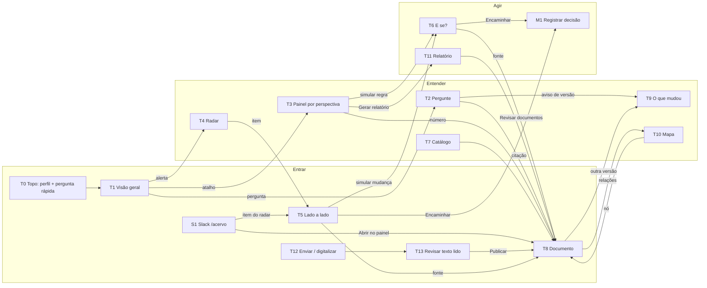

# Fluxo de telas: Clankers · Desafio 2 (PROPOSTA, Planner, 12/11/2026)

**Status:** proposta derivada de `docs/propostas/REQUISITOS-v2.md` (RF/RNF citados abaixo). Só vale depois de aprovada pela equipe.
**Textos de interface:** seguem o guia de voz e tom (`PESQUISA-LEGAL-DESIGN-UX-WRITING.md`) + RNF04/RNF15.
- Conclusão primeiro.
- Data concreta primeiro, D-n entre parênteses.
- Citação no formato RNF14: `NG_111 · v3.0.0 · 4.3.1`.
- Um destaque por tela.
- Toda tela termina com a próxima ação (RF32).

**Inventário:** 15 telas web (T0–T13 + modal M1) e 1 canal externo (S1 Slack).

## 1. Fluxo geral: entrar → entender → agir


**Rotas profundas** (necessárias para o Slack e para os links de citação):

| Rota | Tela |
|---|---|
| `/` | T1 |
| `/perguntar?q=` | T2 |
| `/painel/:perspectiva` | T3 |
| `/radar` | T4 |
| `/radar?item=:id` | T5 |
| `/e-se?regra=&valor=` | T6 |
| `/catalogo` | T7 |
| `/documento/:codigo?versao=#secao-:id` | T8 |
| `/comparar?codigo=&de=&para=` | T9 |
| `/mapa` | T10 |
| `/relatorio?perspectiva=` | T11 |
| `/enviar` | T12 |
| `/enviar/:id` | T13 |

## 2. Estados comuns (componentes reutilizados)
| Estado | Componente | Texto de interface |
|---|---|---|
| Carregando | Esqueleto + `aria-busy` (< 300 ms para aparecer, RNF06) | "Consultando o acervo…" |
| Vazio | Mensagem + atalho | Ver cada tela |
| Erro de API | Faixa junto ao bloco afetado, preservando a entrada (RNF05) | "Não conseguimos falar com o servidor agora. Sua pergunta continua aqui; tente de novo em alguns segundos." + botão "Tentar de novo" |
| Fixture | Selo fixo no topo (RNF08) | "Dados de fixture: a API está fora do ar." |
| Não consta | Cartão neutro (RF05) | "O acervo não trata disso." + "Reformule ou pergunte: <sugestão>." |
| Versão substituída | Selo ⚠ com texto (RF06, RNF02) | "Esta regra mudou: a versão 2.0.0 dizia 30 dias, a vigente 3.0.0 exige 45." + "Ver o que mudou" |
| Simulação | Faixa fixa no topo do T6 (RF20) | "Simulação: nada muda nos documentos até a norma ser revisada." |
| Digitalização | Etapas enviando → lendo → revisar → publicado (RF24–RF26) | "Lendo a página…" · "Algumas linhas ficaram difíceis de ler. Confira os trechos marcados antes de publicar." |
| Citação | Chip clicável (RNF14), com selo extra "digitalizado e revisado por pessoa" quando `origem=digitalizado` | `CTR_2026-012 · v1.0.0 · Cláusula Sétima` |
| Ausente | Selo com contagem (RF19) | "NG_012 citada por 5 documentos, não está no acervo." |

## 3. Telas
Cada tela traz:
- objetivo · perfis;
- componentes;
- dados (endpoint);
- estados;
- textos;
- navegação de entrada e de saída;
- RF/RNF atendidos;
- wireframe.

### T0 Topo global
- **Objetivo:** escolher o perfil, perguntar de qualquer lugar e navegar. **Perfis:** todos.
- **Componentes:** logo; seletor de perfil (6 opções, lembrado no navegador); campo "Pergunte ao acervo"; menu (Visão geral, Painéis, Radar, E se?, Catálogo, Enviar); rodapé com o modo de IA e a data de referência.
- **Dados:** `/api/saude` (`ia`, `data_referencia`).
- **Estados:**
  - normal;
  - API fora → selo de fixture;
  - modo extrativo.
- **Textos:** "Você está vendo como: Gestor". Rodapé: "IA ativa (Amazon Bedrock)" ou "Modo extrativo: respostas montadas só com trechos do acervo". Também "Data de referência: 12/11/2026".
- **Navegação:** entra em qualquer tela; a pergunta leva ao T2.
- **RF/RNF:** RF01, RF07, RF31, RNF03, RNF08.
```
[ACME · Acervo]  Perfil: [Gestor ▾]  [ Pergunte ao acervo…        ][Perguntar]
 Visão geral | Painéis | Radar | E se? | Catálogo | Enviar
 ...
 rodapé: Modo extrativo · Data de referência: 12/11/2026
```

### T1 Visão geral
- **Objetivo:** em 10 s, saber o que exige atenção e por onde começar. **Perfis:** P-DIR (abertura da demo), todos.
- **Componentes:** destaque único (contagem do radar); 4 cartões de perspectiva com 1 número cada; "Próximo prazo"; 3 perguntas sugeridas do perfil; próxima ação.
- **Dados:** `/api/radar` (resumo), `/api/perspectivas`, `/api/perspectivas/{id}` (1 destaque), `/api/saude.data_referencia`.
- **Estados:**
  - carregando;
  - erro de bloco;
  - radar vazio: "Nenhuma divergência encontrada entre os documentos vigentes."
- **Textos:** "3 pontos pedem atenção no acervo." · "Próximo prazo: 25/11/2026, vistoria do coworking (CTR_2026-012 · v1.0.0 · Apêndice C)." · Ação: "Ver os 3 pontos no radar".
- **Navegação:** entra pelo T0 ou por `/`. Sai para o T4 (destaque), o T3 (cartão), o T2 (sugestão) ou o T8 (prazo).
- **RF/RNF:** RF08, RF31, RF32, RF03, RNF11.
```
┌ 3 pontos pedem atenção no acervo        [Ver no radar →] ┐
├ Jurídico ─────┬ Financeiro ────┬ Pessoas ───────┬ Gestão ──────┤
│ Vigência até  │ R$ 18.250,00   │ Pedir férias   │ Orçamento    │
│ 29/04/2027    │ coworking      │ 45 dias antes  │ R$ 96.000,00 │
└───────────────┴────────────────┴────────────────┴──────────────┘
 Próximo prazo: 25/11/2026 · vistoria · CTR_2026-012 · v1.0.0 · Apêndice C
 Pergunte: • Quem aprova o coworking? • Valor total? • Orçamento 2027?
```

### T2 Pergunte ao acervo
- **Objetivo:** resposta confiável, com fonte, na forma do perfil. **Perfis:** todos.
- **Componentes:** campo (mantém o texto); 3 sugestões do perfil; resposta em camadas (conclusão → detalhe → "Ver texto original"); chips de citação; selo de versão; próxima ação. P1: botão "Resumo da conversa".
- **Dados:** `POST /api/perguntar` (`pergunta`, `perfil`) → `resposta`, `consta`, `citacoes[]`, `avisos[]`, `proxima_acao` **[novo]**. P1: `POST /api/resumo-conversa`.
- **Estados:**
  - carregando ("Consultando o acervo…");
  - resposta;
  - **não consta**;
  - **versão substituída**;
  - erro (pergunta preservada).
- **Textos:**
  - P-EMP: "Peça no Portal Raiz, em Solicitar férias, até 21/03/2027 (D-45), com o FM_1111-001." · `NG_111 · v3.0.0 · Anexo C`.
  - Não consta: "O acervo não trata disso. Reformule ou pergunte: Quem aprova documentos? (alçadas)".
  - P-GES: "Decida em 7 dias corridos. Sem decisão, o pedido vai ao diretor da área." · `NG_111 · v3.0.0 · 4.5.2` · `4.6.2`.
- **Navegação:** entra pelo T0, T1, `/perguntar?q=` ou pelo plano B do Slack. Sai para o T8 (citação) ou o T9 (selo).
- **RF/RNF:** RF02–RF06, RF30 (P1), RF32, RNF01, RNF04, RNF05, RNF13, RNF14.
```
[ Uma mesma pessoa pode elaborar, revisar e aprovar?          ][Perguntar]
 Sugestões: • Em quanto tempo decido um pedido? • Quantos podem sair juntos?
┌───────────────────────────────────────────────────────────┐
│ O acervo não trata disso.                                 │
│ Reformule ou pergunte: Quem aprova documentos? (alçadas)  │
└───────────────────────────────────────────────────────────┘
```

### T3 Painel por perspectiva
- **Objetivo:** análise por departamento. **Perfis:** P-FIN, P-JUR, P-RH, P-GES, P-DIR.
- **Componentes:** abas Jurídico, Financeiro, Pessoas e Gestão; 1 destaque; cartões com `fonte`; gráfico de valores com o botão "Ver como tabela"; linha do tempo; matriz de responsáveis; riscos; selo de ausente (Financeiro e Gestão); ações "Simular regra" e "Gerar relatório".
- **Dados:** `/api/perspectivas/{id}` (destaques, valores, prazos com `marco`/`cenario`, responsáveis, riscos, `fonte_anterior`, `aviso`).
- **Estados:**
  - carregando;
  - sem dados: "Ainda não há itens extraídos para esta área.";
  - versão substituída (card 45 dias);
  - ausente.
- **Textos:**
  - Financeiro: "Coworking: R$ 18.250,00 em 5 meses, aprovado pela Diretoria (DIRAF)." · "NG_012 citada por 5 documentos, não está no acervo." · "Multa por inexecução: R$ 912,50 (5%)".
  - Pessoas: "Pedir férias: 45 dias antes (a versão 2.0.0 dizia 30)." · linha do tempo "21/03/2027 (D-45) → 31/03/2027 (D-35) → 05/04/2027 (D-30) → 15/04/2027 (D-20) → 30/04/2027 (pagamento)" com o rótulo "Exemplo: férias a partir de 05/05/2027".
- **Navegação:** entra pelo T1, menu ou `/painel/:id`. Sai para o T8 (qualquer número), o T6 (simular), o T11 (relatório) ou o T4 (selo).
- **RF/RNF:** RF06, RF09, RF10, RF19, RNF03 (tabela equivalente), RNF02.
```
[Jurídico] [Financeiro*] [Pessoas] [Gestão]
┌ Coworking: R$ 18.250,00 em 5 meses · aprovação: Diretoria (DIRAF) ┐
│ CTR_2026-012 · v1.0.0 · Cláusula Sétima   NT_2026-018 · v1.0.0 · 10│
│ ⚠ NG_012 citada por 5 documentos, não está no acervo               │
└────────────────────────────────────────────────────────────────────┘
 Valores [barras]  [Ver como tabela]   Multa R$ 912,50 → Apêndice B
 Prazos: 25/11/2026 vistoria · 30/11/2026 início · 30/03/2027 prorrogação
 [Simular alçada →]  [Gerar relatório →]
```

### T4 Radar de contradições
- **Objetivo:** ver os conflitos e as referências ausentes, sem nada inventado. **Perfis:** P-JUR, P-RH, P-DIR.
- **Componentes:** contadores por status (texto + ícone); filtro por perspectiva; lista de itens (título, tipo, severidade, 2 fontes ou a lista de citantes, próxima ação).
- **Dados:** `GET /api/radar?perspectiva=` → `itens[]` com `fontes`, `codigo_ausente`, `citado_por[]` **[novo]** e `proxima_acao` **[novo]**.
- **Estados:**
  - com itens (lista fechada de 3);
  - vazio pelo filtro: "Nenhuma divergência nesta área entre os documentos vigentes.";
  - erro.
- **Textos:**
  - "Antecedência de férias: a versão 2.0.0 dizia 30 dias, a vigente 3.0.0 exige 45."
  - "Formulário de férias: a versão 1.0.0 pedia 30 dias e envio ao gerente; a 2.0.0 exige 45 dias no Portal Raiz."
  - "NG_012 citada por 5 documentos, não está no acervo."
  - Ações: "Comparar lado a lado", "Encaminhar à GCO".
- **Navegação:** entra pelo T1, menu, selo do T3 ou `/radar` (Slack). Sai para o T5 (item) ou o M1 (encaminhar).
- **RF/RNF:** RF17, RF19, RF32, RNF01.
```
 Divergentes ⚠ 2   Atenção ⓘ 1        Área: [Todas ▾]
 ⚠ Antecedência de férias: v2.0.0 dizia 30 dias, v3.0.0 exige 45
   NG_111 · v2.0.0 · 2.3  ×  NG_111 · v3.0.0 · 4.3.1     [Comparar lado a lado →]
 ⚠ Formulário de férias: v1.0.0 × v2.0.0                  [Comparar lado a lado →]
 ⓘ NG_012 citada por 5 documentos, não está no acervo
   NT_2026-018 · CTR_2026-012 · NG_1130 · PX_1130-001 · NT_2026-021  [Encaminhar à GCO]
```

### T5 Comparação lado a lado
- **Objetivo:** ler as duas passagens e decidir. **Perfis:** P-JUR, P-RH.
- **Componentes:** 2 colunas (versão substituída à esquerda, vigente à direita) com o trecho e a citação; explicação curta; ações "Simular mudança" (quando houver regra), "Encaminhar" e "Abrir documento".
- **Dados:** item do `/api/radar` (`fontes[]`).
- **Estados:**
  - item `versao_substituida`;
  - item `referencia_ausente` (uma coluna com a lista de citantes e o trecho de cada um);
  - item inexistente: "Não encontramos este item. Ele pode ter sido resolvido. Voltar ao radar."
- **Textos:** "A versão vigente prevalece. A 2.0.0 foi substituída." · Ação: "Encaminhar à GGC para revisar os documentos que citam 30 dias".
- **Navegação:** entra pelo T4 ou pelo Slack `/radar?item=`. Sai para o T8, o T6 ou o M1.
- **RF/RNF:** RF18, RF32, RNF14.
```
┌ NG_111 · v2.0.0 · 2.3 (substituída) ┬ NG_111 · v3.0.0 · 4.3.1 (vigente) ┐
│ "…antecedência mínima de 30 dias."  │ "…com antecedência de 45 dias…"   │
└─────────────────────────────────────┴───────────────────────────────────┘
 A versão vigente prevalece.   [Simular mudança →] [Encaminhar à GGC] [Abrir]
```

### T6 E se?
- **Objetivo:** testar uma mudança de regra antes de publicar. **Perfis:** P-RH, P-GES; P-FIN/P-DIR na alçada (⚖️2).
- **Componentes:**
  - faixa fixa de simulação;
  - seletor de regra (antecedência; alçada ⚖️2);
  - valor atual com fonte;
  - campo numérico + slider (1–90), com o erro junto ao campo;
  - linha do tempo antes/depois do exemplo de 05/05/2027 (data primeiro, D-n entre parênteses);
  - lista de conflitos com fonte;
  - lista "Documentos a revisar" (só vigentes);
  - próxima ação.
- **Dados:** `GET /api/regras`, `POST /api/simular` → `linha_do_tempo[]`, `impactos[]` (tipos novos **[novo]**), `resumo[]`, `aviso` (lista **[novo]**), `proxima_acao` **[novo]**.
- **Estados:**
  - atual (N=45: "Nenhuma mudança: este é o valor vigente.");
  - **simulado**;
  - valor fora da faixa;
  - conflito;
  - carregando;
  - erro.
- **Textos:**
  - "Com 30 dias, o pedido vai até 05/04/2027 (D-30), depois do prazo do aviso, 31/03/2027 (D-35)."
  - "4 regras ficam em conflito." · "Revisar 5 documentos antes de publicar a mudança."
  - Erro: "Use um número entre 1 e 90 dias."
  - Alçada ⚖️2: "A regra de alçada está na NG_012, que não está no acervo; a simulação usa os valores citados pela NT_2026-018." e "A contratação foi aprovada em 09/11/2026; a simulação não reabre essa aprovação."
- **Navegação:** entra pelo T3, T5 ou `/e-se`. Sai para o T8 (documento a revisar) ou o M1.
- **RF/RNF:** RF20, RF21 ⚖️2, RF32, RNF04, RNF05.
```
══ Simulação: nada muda nos documentos até a norma ser revisada ══
 Regra: [Antecedência para pedir férias ▾]   Hoje: 45 dias · NG_111 · v3.0.0 · 4.5.1
 Novo valor: [ 30 ] dias  ◄────●──────►      (erro aqui, junto ao campo)
 Exemplo: férias a partir de 05/05/2027
   Pedido   21/03/2027 (D-45) → 05/04/2027 (D-30)  ⚠ muda
   Aviso    31/03/2027 (D-35)   = sem mudança → ⚠ fica antes do pedido
 Conflitos (4): aviso 4.5.3 · gestor 4.5.2 · assinatura 4.5.4 · 4.3.3
 Documentos a revisar (5): NG_111 · PX_1111-001 · FM_1111-001 · TB_1111-001 · FL_1111-001
 [Encaminhar à GGC]
```

### T7 Catálogo
- **Objetivo:** encontrar documentos. **Perfis:** todos.
- **Componentes:** busca; filtros (assunto, tipo, vigente/substituído, origem acervo/enviado/digitalizado); lista agrupada por assunto com selos; "Enviar documento"; decodificador de código (P1, RF16).
- **Dados:** `/api/documentos` (`origem` **[novo]**), P1 `/api/codigo/{codigo}`.
- **Estados:**
  - lista (13; 12 no modo demo antes da digitalização);
  - sem resultado: "Nenhum documento com 'xyz'. Tente pelo código, como NG_111.";
  - erro.
- **Textos:** selos "Vigente", "Substituída", "Digitalizado e revisado por pessoa".
- **Navegação:** entra pelo menu ou pelo T13 (depois de publicar). Sai para o T8 ou o T12.
- **RF/RNF:** RF11, RF16 (P1), RF26.
```
[ Buscar por código ou título ]  Assunto [▾] Tipo [▾] Situação [▾] Origem [▾]  [Enviar documento]
 Férias:   NG_111 v3.0.0 Vigente · NG_111 v2.0.0 Substituída · PX_1111-001 · FM_1111-001 …
 Locação:  CTR_2026-012 · NT_2026-018
```

### T8 Documento
- **Objetivo:** ler a fonte com a seção citada em destaque. **Perfis:** todos.
- **Componentes:** cabeçalho (código, título, versão, fase, vigência, vinculado a, elaborado e aprovado por); seletor de versão; sumário de seções; seção citada destacada e com foco; selo "Substituída" com link para a vigente; para documento digitalizado, o link "Ver imagem original"; ações "O que mudou" e "Relações".
- **Dados:** `/api/documentos/{codigo}?versao=` (+ `origem`, `revisado_por`, `revisado_em` **[novo]**).
- **Estados:**
  - vigente;
  - **versão substituída**;
  - seção citada;
  - documento inexistente: "Não encontramos FL_9999. Confira o código ou volte ao catálogo.";
  - erro.
- **Textos:** "Você está lendo a versão 2.0.0, substituída. A vigente é a 3.0.0." [Abrir vigente].
- **Navegação:** entra por qualquer citação, pelo T7, pelo Slack ou pelo T13. Sai para o T9 ou o T10.
- **RF/RNF:** RF04, RF10, RF12, RNF02, RNF10 (Markdown sem HTML ativo).
```
 NG_111 · Férias · v[3.0.0 ▾] · Vigente · 03/08/2026 a 03/02/2028
 Sumário | 4.3 Solicitação
          ▌4.3.1 A solicitação é formal… com antecedência de 45 dias…  ← destacado
 [O que mudou] [Relações]
```

### T9 O que mudou
- **Objetivo:** ver as diferenças entre versões. **Perfis:** P-JUR, P-RH.
- **Componentes:** seletor de código e versões; resumo em frases curtas; diferenças por seção (antes/depois), com tipo (alterado, incluído, removido) em texto.
- **Dados:** `/api/comparar` (+ `anterior_ausente`, `declaradas` **[novo]**).
- **Estados:**
  - comparação;
  - **versão anterior ausente**: "A versão 1.0.0 não está no acervo. Diferenças declaradas no Anexo K:" + texto com `RG_1100 · v2.0.0 · Anexo K`;
  - sem versões: "Este documento tem só uma versão no acervo."
- **Textos:** "A antecedência passou de 30 para 45 dias."
- **Navegação:** entra pelo T8 ou pelo selo de versão (T2, T3). Sai para o T8.
- **RF/RNF:** RF13.
```
 NG_111  de [2.0.0 ▾] para [3.0.0 ▾]
 Resumo: • Antecedência 30 → 45 dias • Prazos em camadas (novo 4.5)
 2.3 → 4.3.1  alterado   antes: "…30 dias."   depois: "…45 dias…"
```

### T10 Mapa do acervo (P1 no corte)
- **Objetivo:** ver as relações entre documentos. **Perfis:** P-JUR.
- **Componentes:** grafo (cor + forma por tipo; tracejado para substituídos; borda pontilhada + rótulo para ausentes); "mostrar substituídos"; lista equivalente em texto (RNF03).
- **Dados:** `/api/grafo` (`existe_no_acervo`).
- **Estados:**
  - grafo;
  - nó ausente selecionado: "NG_012 não está no acervo. Citada por: …";
  - erro.
- **Navegação:** entra pelo T8 ou pelo menu. Sai para o T8 (nó).
- **RF/RNF:** RF14, RNF03.
```
 [x] mostrar substituídos      [Ver como lista]
 NG_111 ── PX_1111-001 ── FM/TB/FL      CTR_2026-012 ⇄ NT_2026-018 ┄┄ (NG_012 ausente)
```

### T11 Relatório executivo (P1 no corte)
- **Objetivo:** levar a síntese para a reunião. **Perfis:** P-DIR.
- **Componentes:** escolha da perspectiva; prévia; "Imprimir" (CSS de impressão, até 2 páginas A4); fontes por extenso; P1 síntese pelo Bedrock com fonte.
- **Dados:** `/api/relatorio?perspectiva=`.
- **Estados:** prévia; impressão; erro.
- **Textos:** "Gerado em 12/11/2026 a partir do acervo ACME. Cada afirmação traz a fonte."
- **Navegação:** entra pelo T3. Sai para o T8 (fonte) ou a impressão.
- **RF/RNF:** RF15, RNF14.
```
 Relatório · Jurídico/Contratos · 12/11/2026            [Imprimir]
 1. Vigência 30/11/2026 a 29/04/2027 — CTR_2026-012 · v1.0.0 · Cláusula Segunda
 2. Rescisão até o 90º dia: multa de 1 aluguel — … · Cláusula Décima Terceira
```

### T12 Enviar e digitalizar
- **Objetivo:** trazer um documento novo (digital ou foto). **Perfis:** P-JUR, P-RH.
- **Componentes:** área de soltar arquivo + botão; tipos e limites visíveis; exemplo ao lado (Hagan); progresso por etapa; lista de rascunhos em revisão.
- **Dados:** `POST /api/documentos` (digital), `POST /api/digitalizacoes` **[novo]** (foto), `GET /api/digitalizacoes/{id}` **[novo]**.
- **Estados:**
  - vazio;
  - **enviando**;
  - **lendo**;
  - publicado (digital → T8);
  - erros: tipo ("Este tipo de arquivo não é aceito. Envie PDF, Markdown, JPG ou PNG."), tamanho ("O arquivo tem 14 MB e o limite é 10 MB. Reduza a resolução da foto e envie de novo."), leitura ("Não deu para ler esta foto. Tente com mais luz e a página inteira no quadro."), sem motor ("Não conseguimos ler imagens agora. Envie a versão em PDF com texto ou em Markdown.").
- **Navegação:** entra pelo menu ou pelo T7. Sai para o T13 (foto) ou o T8 (digital).
- **RF/RNF:** RF23, RF24, RNF05, RNF10.
```
┌ Solte aqui um PDF, Markdown ou foto de 1 página (até 10 MB) ┐
│                  [Escolher arquivo]                         │
└─────────────────────────────────────────────────────────────┘
 Exemplo: foto da página inteira, com boa luz.
 Etapas: ● Enviando  ○ Lendo  ○ Revisar  ○ Publicado
```

### T13 Revisar texto lido
- **Objetivo:** uma pessoa confere a leitura antes de o texto virar fonte. **Perfis:** P-JUR, P-RH.
- **Componentes:** imagem da página; texto lido editável por linha; linhas incertas com ícone ⚠ + "incerta" + caixa "Conferi"; cabeçalho sugerido (Documento, Título, Sigla e Número, Versão, Fase, Vigência) com os campos obrigatórios marcados; "Publicar" (desabilitado com o motivo visível); "Salvar rascunho". P1: rolagem sincronizada.
- **Dados:** `GET/PUT /api/digitalizacoes/{id}`, `POST /api/digitalizacoes/{id}/publicar` **[novo]**.
- **Estados:**
  - **revisar**;
  - baixa confiança (> 20%) com faixa;
  - publicar bloqueado: "Falta conferir 2 linhas e preencher a Versão.";
  - duplicado: "Já existe FL_1111-001 v1.0.0. Altere a versão ou cancele.";
  - publicado: "FL_1111-001 v1.0.0 publicado. Ele já pode ser citado.";
  - erro.
- **Navegação:** entra pelo T12. Sai para o T8 (publicado) ou o T7.
- **RF/RNF:** RF25, RF26, RNF03, RNF05.
```
┌ [imagem da página] ┬ Texto lido                                   ┐
│                    │ Empregado solicita no Portal Raiz – até D-45 │
│                    │ ⚠ incerta: GGC emite av?so – até D-35 [ ]Conferi │
└────────────────────┴──────────────────────────────────────────────┘
 Cabeçalho: Documento [Fluxo] Sigla e Número* [FL_1111-001] Versão* [1.0.0] Título* [Fluxograma de Férias]
 Falta conferir 1 linha.          [Salvar rascunho]  [Publicar] (desabilitado)
```

### M1 Registrar decisão (⚖️4)
- **Objetivo:** fechar o ciclo e encaminhar com responsável. **Perfis:** P-RH, P-JUR, P-GES.
- **Componentes:** item de origem (resumo + fontes); ação (encaminhar para revisão, aceitar, descartar); responsável (sugerido por RF32: GGC, GCO); nota; "Registrar"; histórico.
- **Dados:** `POST/GET /api/decisoes` (v0.2 P1 → promover).
- **Estados:**
  - formulário;
  - sucesso: "Encaminhado à GGC em 12/11/2026, 14h32. Você pode acompanhar no histórico.";
  - erro (nota preservada).
- **Navegação:** entra pelo T4, T5, T6 ou pelo Slack (P1). Sai e volta para a origem.
- **RF/RNF:** RF22, RF29 (P1), RNF15.
```
 Encaminhar: Antecedência de férias 30 × 45   (NG_111 · v2.0.0 · 2.3 × v3.0.0 · 4.3.1)
 Ação (•) Encaminhar para revisão  Responsável [GGC ▾]  Nota [ …………… ]
                                                    [Cancelar] [Registrar]
```

### S1 Slack (canal externo, ⚖️1)
- **Objetivo:** consultar sem sair do fluxo de trabalho. **Perfis:** todos.
- **Componentes:** `/acervo <pergunta>`, `/acervo radar`, `/acervo ajuda`; resposta Block Kit (conclusão, até 3 citações, aviso de versão, próxima ação, "Abrir no painel"); "Ver resposta normal" quando o pedido for roteado ao radar.
- **Dados:** `/api/perguntar`, `/api/radar`.
- **Estados:**
  - "Consultando o acervo…" (< 3 s);
  - resposta;
  - não consta;
  - radar;
  - API fora: "Não consegui consultar o acervo agora. Tente de novo em alguns segundos ou use o painel: <link>."
- **Navegação:** sai para o T8 (citação), o T5 (item do radar) ou o T2.
- **RF/RNF:** RF27, RF28, RNF08, RNF14.
```
/acervo quais regras mudaram e estão em conflito?
Acervo  3 pontos pedem atenção:
 ⚠ Antecedência de férias: v2.0.0 dizia 30, a vigente v3.0.0 exige 45 · NG_111 · v3.0.0 · 4.3.1
 ⚠ Formulário de férias v1.0.0 × v2.0.0 · FM_1111-001 · v2.0.0
 ⓘ NG_012 citada por 5 documentos, não está no acervo
 Próxima ação: encaminhar à GGC.   [Abrir no painel] [Ver resposta normal]
```

## 4. Jornadas dos 6 perfis
| Perfil | Jornada (tela → tela) | Termina em |
|---|---|---|
| P-EMP | T0 (perfil Empregado) → T2 "Até quando peço férias que começam em 05/05/2027?" → "Peça no Portal Raiz até 21/03/2027 (D-45)" → chip `NG_111 · v3.0.0 · Anexo C` → T8 | Ação: pedir no Portal Raiz |
| P-GES | T1 → T3 Pessoas → linha do tempo do exemplo → T2 "Em quanto tempo decido um pedido?" → "7 dias corridos; sem decisão, vai ao diretor" (`4.5.2`, `4.6.2`) → T8 | Ação: decidir em 7 dias |
| P-DIR | T1 (destaque "3 pontos") → T4 → T5 (NG_012) → T11 Jurídico/Contratos → Imprimir | Relatório na reunião |
| P-FIN | T3 Financeiro → R$ 18.250,00 + DIRAF + selo NG_012 → R$ 912,50 → T8 Apêndice B → (⚖️2) T6 alçada 20.000 | Ver o aprovador mudar na simulação |
| P-JUR | T4 → T5 FM v1.0.0 × v2.0.0 → T9 NG_111 2.0.0 → 3.0.0 → T9 RG_1100 (Anexo K) → T10 (P1) | Encaminhar à GCO (M1) |
| P-RH | T4 (30 × 45) → T5 → "Simular mudança" → T6 N=30 → 4 conflitos + 5 documentos → M1 "Encaminhar à GGC" | Decisão registrada |

## 5. Roteiro da demo (6 passos, tela a tela, ≈ 2 min)
Pré-condição: modo demo com `ACERVO_RESERVADOS=FL_1111-001`, `DATA_REFERENCIA=2026-11-12`, API real (fixture só em contingência), perfil inicial Diretoria.

| Passo | Telas | O que mostrar | Fala-âncora | Plano B |
|---|---|---|---|---|
| 1 | T7 (12 documentos) → T12 (foto da página impressa do FL_1111-001) → T13 (1 linha incerta → "Conferi" → Publicar) → T7 (13) | O papel vira fonte citável em < 1 min, com revisão humana | "Nada vira fonte sem uma pessoa conferir." | Se a leitura falhar: subir o FL em .md pelo T12 (RF23) |
| 2 | S1 `/acervo quais regras mudaram e estão em conflito?` | 3 pontos com fonte + "Abrir no painel" | "No Slack, onde o time já trabalha." | ⚖️1 = não ou Slack fora: T2 com a mesma pergunta → T4 |
| 3 | S1 "Abrir no painel" → T4 → T5 (NG_111 2.0.0 × 3.0.0) | As 2 passagens lado a lado; NG_012 citada por 5 documentos | "Não citamos o documento: citamos o número, e avisamos se envelheceu." | Web direto em `/radar` |
| 4 | T3 Jurídico ↔ Financeiro → R$ 18.250,00 → T8 Cláusula Sétima; multa → Apêndice B | Mesma fonte, perspectivas diferentes | "Cada número abre o trecho exato." | — |
| 5 | T6 antecedência N=30 → conflito D-35 + 5 documentos; (⚖️2) alçada 20.000 → sai da diretoria + 2 avisos | Simular antes de publicar | "O RH testa a regra antes de mudar a norma." | ⚖️2 = não: só a antecedência (D4) |
| 6 | T6 → M1 "Encaminhar à GGC" → sucesso com data e hora | O ciclo fecha na decisão | "Da leitura à decisão registrada." | ⚖️4 = não: fala apontando o botão P1 |

## 6. O que o FE precisa da API e NÃO está no contrato (proposta de mudança)
Mesmo conteúdo da §7 da REQUISITOS-v2, visto pelo FE. Tudo é aditivo e exige o adendo v0.3 aprovado pelo Lead.

| # | Necessidade do FE | Tela | Proposta |
|---|---|---|---|
| C1 | Perfis Diretoria, Jurídico e RH no `perfil` | T0, T2 | enum `empregado\|gestor\|diretoria\|financeiro\|juridico\|rh` + aliases v0 |
| C2 | Próxima ação pronta, sem montar texto no FE | T2, T4, T5, T6, S1 | `proxima_acao` (string) em perguntar, radar e simular |
| C3 | Lista de documentos que citam a norma ausente | T3, T4, T5, T10, S1 | `citado_por[]` no item `referencia_ausente`; 1 item por norma; só citações de documentos vigentes |
| C4 | Data de referência | T0, T1, T3, T6 | `data_referencia` em `/api/saude`; perspectivas e simular usam essa data |
| C5 | Tipos de conflito do "E se?" e mais de um aviso | T6 | `impactos[].tipo` = `conflito_aviso\|conflito_decisao_gestor\|conflito_assinatura\|revisar_documento`; `aviso` como lista |
| C6 | Comparar sem a versão anterior, sem 404 | T9 | `/api/comparar` → 200 com `anterior_ausente:true` + `declaradas:{fonte}` (RG_1100 Anexo K) |
| C7 | Origem e revisão do documento | T7, T8, chips | `origem` = `acervo\|upload\|digitalizado`, `revisado_por`, `revisado_em` em `/api/documentos` |
| C8 | Digitalização | T12, T13 | `POST /api/digitalizacoes`, `GET/PUT /api/digitalizacoes/{id}`, `POST …/publicar` (formato na v1 §6.3; P0 = 1 imagem) |
| C9 | Registrar decisão e alçada no P0 | M1, T6 | Promover `/api/decisoes` (⚖️4) e `alcada_gerente_max` (⚖️2) de P1 para P0 |
| C10 | Upload digital no P0 | T12 | Promover `POST /api/documentos` (v0.2 P1) |
| C11 | Mensagens de erro amigáveis vindas da API | T12, T13, T6 | `detail` em português, no texto do guia (409, 413, 415, 422), para o FE exibir junto ao campo |
| C12 | Link para a imagem original do digitalizado | T8 | `imagem_url` no documento com `origem=digitalizado` |
