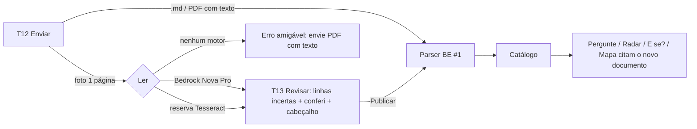

# Requisitos v2: Clankers · Desafio 2 (PROPOSTA, Planner, 12/11/2026)

**Status:** proposta. Só vale depois de aprovada pela equipe; não altera issues, PRD nem contrato.
**Base:** `REQUISITOS-v1.md` + `QA-REQUISITOS.md` (Sextante e Bússola), `ESCOPO-PROJETO.md`, `PESQUISA-LEGAL-DESIGN-UX-WRITING.md`, `REQUISITOS-E-FLUXO-DE-TELAS.md`, `CONTRATO-API-ADENDO-v0.2.md`, `EVENTO.md` e o acervo em `docs/acervo/`.

**Convenções:**
- ⚖️ = depende das decisões 1–4 do ESCOPO: (1) Slack no MVP; (2) "E se?" da alçada; (3) documentos fictícios; (4) registrar decisão. O texto mantém a **recomendação do ESCOPO** (1 = sim, 2 = acervo, 3 = não usar, 4 = sim).
- **Conflito de esforço:** com as 4 decisões ⚖️ como "sim", as fatias novas F2–F8 somam ≈ 15–22 h. Isso não cabe junto com o P0 atual na janela até ~07h30 de 13/11 (fim inferido), menos 4–6 h de reserva. Cortes na ordem da §9.
- **Formato de citação:** `PX_1111-001 · v1.0.0 · Anexo D` (RNF14). O id interno de seção continua sendo o `secoes[].id` da BE #1 (ex.: `CLÁUSULA SÉTIMA`); a tela exibe "Cláusula Sétima".
- Endpoint **[novo]** = fora dos contratos v0/v0.1/v0.2; exige o adendo v0.3 (§7) aprovado pelo Lead.
- **Data de referência** ("hoje" da demo) = `DATA_REFERENCIA`, padrão 12/11/2026 (RF31).

## 0. O que mudou após o QA
| ID | Origem | Mudança |
|---|---|---|
| RF02 | Sextante, Bússola | Gestor: "7 dias corridos" agora cita NG_111 · v3.0.0 · 4.5.2, e a consequência ("vai ao diretor da área") cita a 4.6.2. Aceite com 1 caso por perfil (6 casos). Resposta termina com a próxima ação (RF32). |
| RF03 | Bússola | Lista fixa de 18 perguntas sugeridas (3 por perfil) com resposta esperada e fonte (§2.6), incluídas no eval (RNF13). |
| RF05 | Bússola | Sem "quem procurar" genérico. Exibe só a sugestão de pergunta, a menos que o assunto tenha um responsável no acervo (tabela fixa por assunto em §2.6). |
| RF08 | Bússola, L2 | "Próximo prazo" calculado a partir da `DATA_REFERENCIA`. Valor esperado: 25/11/2026, vistoria (CTR_2026-012 · v1.0.0 · Apêndice C). |
| RF09 | Bússola | Aceite com 1 valor conferido por painel (Financeiro, Pessoas, Jurídico, Gestão). |
| RF13 | Sextante | RG_1100: "versão anterior não está no acervo; diferenças declaradas no Anexo K", com fonte RG_1100 · v2.0.0 · Anexo K. |
| RF14 | Bússola | Mesma regra do radar: só cita como ausente o que é referido por documento **vigente**. NG_010 (citada só pela NG_111 v2.0.0) aparece no mapa apenas com "mostrar substituídos" ligado. |
| RF15 | Bússola | Aceite objetivo: cada afirmação com citação por extenso, até 2 páginas A4, cor nunca como único sinal. |
| RF16 | Bússola | Reclassificado: P0 só no backend (BE #3); a tela do decodificador vira P1. |
| RF17 | Sextante, Bússola | Lista fechada de 3 itens (§2.3), com referência ausente agrupada **por norma** e a lista de documentos que a citam ("NG_012 citada por 5 documentos"). NG_010 e RG_1100 v1.0.0 ficam fora do radar. Cada item termina com uma ação. |
| RF19 | Bússola | Selo também no painel Gestão (NG_1130 · v1.0.0 · 4.9 cita a NG_012) e lista os 5 documentos citantes. |
| RF20 | Sextante, Bússola | Conflitos completos e regras explícitas: aviso (N < 35), decisão do gestor (N < 42), assinatura (N ≤ 30) e 4.3.3 (sempre que N ≠ 45). Casos N=30, 35, 40 e 45. Erro "Use um número entre 1 e 90 dias." ao lado do campo. Data primeiro, D-n entre parênteses. |
| RF21 | Sextante | DIRAF citada pela NT_2026-018 · v1.0.0 · seção 10 (o Anexo F só diz "Diretor"). Aviso obrigatório sobre a NG_012 ausente. Nota de que a NT foi aprovada em 09/11/2026 (seção 12) e a simulação não reabre a aprovação. |
| RF22 | Sextante | Persistência em JSONL no MVP, com justificativa (Viabilidade 10.3) e migração para PostgreSQL no mês 1 do plano de 6 meses. Texto de voz e tom para "decisão registrada". |
| RF24 | Bússola | Recorte: P0 = 1 página .jpg/.png. PDF escaneado com várias páginas → P1. "Acervo legado em papel" tratado como hipótese no pitch. |
| RF25 | Bússola | Rolagem sincronizada → P1. P0 = linhas incertas marcadas (ícone + texto), "conferi" e campos obrigatórios. |
| RF26 | Sextante (opção A) | No modo demo, o acervo inicial sobe **sem o FL_1111-001** (12 documentos), e a página impressa do FL é digitalizada no palco (12 → 13), sem 409. Os testes padrão continuam com 13. |
| RF28 | Sextante, Bússola | Amarrado à lista fechada do RF17. Botão "Ver resposta normal" quando o roteamento leva ao radar. |
| RF31 | Bússola L2 | **Novo:** data de referência configurável. |
| RF32 | Bússola L3 | **Novo:** toda resposta, item do radar e simulação termina com 1 próxima ação. |
| RNF04 | Sextante, Bússola | Passa a "boas práticas de linguagem simples" até a Lei 15.263/2025 ser conferida na fonte oficial. Glossário com fonte (`glossario.json`). Teste com 2 pessoas: as duas acham "21/03/2027" em < 60 s. Regra "data primeiro, D-n entre parênteses". |
| RNF05 | Bússola | Teste de "perto do problema" e texto do erro do RF20. |
| RNF03 | Sextante | Requisito mantido; não afirmar no pitch que acessibilidade é critério oficial 10.4 até conferir o texto integral. |
| RNF13 | Bússola L1 | **Novo:** eval (`eval/perguntas.yaml`). |
| RNF14 | Bússola D1 | **Novo:** formato único de citação. |
| RNF15 | Bússola (voz e tom) | **Novo:** textos de "Consultando o acervo…" e "decisão registrada" no guia. |
| §9 | Bússola L4, Sextante P5 | **Novo:** ordem de corte. |
| — | — | Nenhum RF removido. Nenhum item recebeu "remover" no QA. |

## 1. Perfis
O perfil muda **a forma e a ordem** da resposta, **nunca o conteúdo nem as fontes**.
| Id | Perfil | Ordem da resposta | Telas principais |
|---|---|---|---|
| P-EMP | Empregado | O que fazer → até quando → onde → fonte | Pergunte, Documento |
| P-GES | Gestor | O que decidir → prazo → o que acontece se não decidir → fonte | Pergunte, Painel Pessoas, Radar |
| P-DIR | Diretoria | Conclusão em 1 linha → valor → risco → quem aprova | Visão geral, Radar, Relatório |
| P-FIN | Financeiro (Gerência Financeira, GFI) | Valores e datas → multas → fonte | Painel Financeiro, E se? |
| P-JUR | Jurídico/Contratos (Gerência de Contratos, GCO) | Cláusula e vigência → conflitos → texto original | Painel Jurídico, Radar, O que mudou, Mapa |
| P-RH | RH (Gerência de Gente e Cultura, GGC) | Regra atual → impacto → documentos a revisar | E se?, Radar, Painel Pessoas |

Mapa para o contrato (D2): `empregado`, `gestor`, `diretoria`, `financeiro` (alias v0 `gfi`), `juridico` (alias `gco`), `rh` (alias `ggc`). Ver §7.1.

## 2. Requisitos funcionais

### 2.1 Núcleo: confiança e consulta
| RF | Descrição | Perfis | Prior. | Tela | Endpoint | Regra · fonte | Critério de aceite testável |
|---|---|---|---|---|---|---|---|
| RF01 | Escolher o perfil no topo, com a escolha lembrada no navegador | todos | P0 | T0 | `perfil` em POST /api/perguntar | O perfil não altera as fontes | O conjunto de `citacoes` é idêntico para os 6 perfis (teste FE e BE) |
| RF02 | Resposta em camadas por perfil (conclusão → detalhe → texto original), terminando com a próxima ação (RF32) | todos | P0 | T2 | POST /api/perguntar | Modelos da PESQUISA | 6 casos, 1 por perfil, com a 1ª frase esperada. P-EMP "Até quando peço férias que começam em 05/05/2027?" → contém "21/03/2027" (NG_111 · v3.0.0 · Anexo C; PX_1111-001 · v1.0.0 · Anexo D). P-GES "Em quanto tempo decido um pedido de férias?" → "7 dias corridos" (NG_111 · v3.0.0 · 4.5.2) + "sem decisão, o pedido vai ao diretor da área" (4.6.2). P-DIR "Quem aprova o coworking?" → "Diretoria (DIRAF)" (NT_2026-018 · v1.0.0 · seção 10). P-FIN "Qual a multa por inexecução?" → "R$ 912,50" (CTR_2026-012 · v1.0.0 · Apêndice B). P-JUR "Qual a vigência do coworking?" → "30/11/2026 a 29/04/2027" (CTR_2026-012 · Cláusula Segunda). P-RH "Qual a antecedência para pedir férias?" → "45 dias corridos" (NG_111 · v3.0.0 · 4.3.1), com o aviso da v2.0.0 |
| RF03 | Perguntar em linguagem natural, com as 3 perguntas sugeridas do perfil (lista fixa em §2.6) | todos | P0 | T2 | POST /api/perguntar | §2.6 | As 18 sugestões estão no eval com a resposta esperada; clicar envia; a pergunta fica no campo depois da resposta e em caso de erro |
| RF04 | Toda afirmação traz citação clicável no formato RNF14 | todos | P0 | T2, T3, T4, T11, Slack | `citacoes[]`, `fonte` | v0.1 A | O clique abre o T8 rolado na seção; `fonte.secao ∈ secoes[].id` em 100% dos itens |
| RF05 | Estado "não consta nas fontes", com sugestão de pergunta. Mostra "quem procurar" só se o assunto tiver responsável no acervo (§2.6) | todos | P0 | T2, Slack | `consta=false` | Abaixo do limiar → `citacoes=[]`; o CATÁLOGO não entra no índice | "Uma mesma pessoa pode elaborar, revisar e aprovar?" → `consta=false`; a tela mostra "O acervo não trata disso." + 1 sugestão; não mostra "quem procurar" (o assunto não tem responsável no acervo) |
| RF06 | Aviso quando a fonte é uma versão substituída, mostrando a vigente | todos | P0 | todas com fonte | `avisos[]`, `fonte_anterior` (v0.1 F) | NG_111 · v2.0.0 · 2.3 × NG_111 · v3.0.0 · 4.3.1 | Card "45 dias", selo "vigente v3.0.0", aviso "a versão 2.0.0 dizia 30 dias" (ícone + texto) |
| RF07 | Indicador do modo de IA ("IA ativa" ou "modo extrativo") | todos | P1 | T0 | `/api/saude.ia` | 8.2.5 | Com `LLM_PROVIDER=nenhum`, o rodapé mostra "modo extrativo" |
| RF31 | Data de referência ("hoje") configurável para prazos e destaques | todos | P0 | T1, T3, T6 | `/api/saude.data_referencia` **[novo]** | `DATA_REFERENCIA` (padrão 2026-11-12) | Com 2026-11-12, o "próximo prazo" do T1 é 25/11/2026; com 2026-11-26, é 30/11/2026 |
| RF32 | Próxima ação: toda resposta, item do radar e simulação termina com 1 ação concreta | todos | P0 | T2, T4, T5, T6, Slack | `proxima_acao` **[novo]** | Regra fixa por tipo de resultado (§2.6) | Resposta do empregado termina com "Peça no Portal Raiz até 21/03/2027."; item NG_012 com "Encaminhar à GCO"; simulação N=30 com "Revisar 5 documentos" |

### 2.2 Painéis, documentos e relatórios
| RF | Descrição | Perfis | Prior. | Tela | Endpoint | Regra · fonte | Aceite |
|---|---|---|---|---|---|---|---|
| RF08 | Visão geral: contagem do radar, números-chave e próximo prazo (RF31), com atalhos | P-DIR, todos | P0 | T1 | /api/saude, /api/radar, /api/perspectivas | — | Mostra "3 itens no radar", R$ 18.250,00 e "Próximo prazo: 25/11/2026, vistoria (CTR_2026-012 · v1.0.0 · Apêndice C)"; todo número é clicável |
| RF09 | Painel por perspectiva: destaques, gráfico de valores, linha do tempo, matriz de responsáveis e riscos | P-FIN, P-JUR, P-RH, P-GES | P0 | T3 | /api/perspectivas/{id} | ver aceite | 1 valor conferido por painel. **Financeiro:** R$ 18.250,00 (CTR_2026-012 · v1.0.0 · Cláusula Sétima) e R$ 912,50 (Apêndice B). **Pessoas:** 21/03/2027 (NG_111 · v3.0.0 · Anexo C). **Jurídico:** multa de 1 aluguel na rescisão até o 90º dia (CTR_2026-012 · Cláusula Décima Terceira). **Gestão:** orçamento de R$ 96.000,00 (NT_2026-021 · v1.0.0 · 4.5). Cada gráfico tem tabela equivalente |
| RF10 | Todo número, prazo e item abre o trecho de origem | todos | P0 | T3 → T8 | `fonte` | — | R$ 912,50 abre o T8 no Apêndice B com o trecho destacado |
| RF11 | Catálogo com filtros (assunto, tipo, vigente/substituído, origem) e busca | todos | P0 | T7 | /api/documentos | O CATÁLOGO é referência e não entra na contagem | Modo padrão: 13 (11 vigentes e 2 substituídos). Modo demo (RF26): 12 antes da digitalização e 13 depois, com o FL marcado "digitalizado" |
| RF12 | Leitor: cabeçalho, seções, âncora, destaque da seção citada e troca de versão | todos | P0 | T8 | /api/documentos/{codigo}?versao= | Sem versão, abre a vigente | `/documento/NG_111` abre a v3.0.0; o seletor mostra a v2.0.0 "substituída" |
| RF13 | O que mudou: diferenças por seção + resumo; versão anterior ausente com diferenças declaradas pelo próprio documento | P-JUR, P-RH | P0 | T9 | /api/comparar; `/api/documentos/RG_1100` | NG_111 v2.0.0 → v3.0.0; FM_1111-001 v1.0.0 → v2.0.0; RG_1100 · v2.0.0 · Anexo K | NG_111 lista 30 → 45. RG_1100 mostra "A versão 1.0.0 não está no acervo. Diferenças declaradas no Anexo K:" + o texto do Anexo K com fonte |
| RF14 | Mapa do acervo: relações, substituídos tracejados, nós ausentes pela mesma regra do radar | P-JUR | P0 (P1 no corte, §9) | T10 | /api/grafo | Ausente = citado por documento vigente | NG_012 aparece "ausente" com 5 arestas; NG_010 só aparece com "mostrar substituídos" ligado |
| RF15 | Relatório executivo por perspectiva, para imprimir | P-DIR | P0 (P1 no corte, §9) | T11 | /api/relatorio | — | Jurídico/Contratos: cada afirmação com citação por extenso (RNF14), até 2 páginas A4, sem depender de cor |
| RF16 | Decodificar código de documento | todos | P0 só backend (BE #3); tela P1 | T7 | /api/codigo/{codigo} | CATÁLOGO, seções 2, 3 e 5 | Os 7 casos da BE #3 |

### 2.3 Diferenciais: radar, "E se?" e decisão
**Lista fechada do radar (P0):**
1. `versao_substituida`: NG_111 v2.0.0 · 2.3 (30 dias) × v3.0.0 · 4.3.1 (45 dias corridos).
2. `versao_substituida`: FM_1111-001 v1.0.0 (30 dias, envio ao gerente) × v2.0.0 (45 dias, Portal Raiz).
3. `referencia_ausente`: **NG_012**, citada por 5 documentos vigentes: NT_2026-018 (Anexo F), CTR_2026-012, NG_1130 (4.9), PX_1130-001 e NT_2026-021.

**Fora do radar:**
- NG_010: só a NG_111 v2.0.0, substituída, a cita. Vai para o histórico.
- RG_1100 v1.0.0: não há conflito de texto. Vai para o RF13 via Anexo K.

| RF | Descrição | Perfis | Prior. | Tela | Endpoint | Regra · fonte | Aceite |
|---|---|---|---|---|---|---|---|
| RF17 | Radar por severidade, com filtro por perspectiva; ausência agrupada por norma, com a lista de citantes; cada item termina com uma ação (RF32) | P-JUR, P-RH, P-DIR | P0 | T4 | /api/radar (v0.2 + `citado_por[]` **[novo]**) | Só regras determinísticas, sem IA | Os itens = **a lista fechada acima, nenhum fora dela**; o item NG_012 traz `citado_por` com os 5 códigos; o teste reutiliza o do RNF02 (D3); estado "nenhuma divergência" quando o filtro esvazia |
| RF18 | Comparação lado a lado das duas fontes | P-JUR, P-RH | P0 | T5 | `itens[].fontes` | — | 2 passagens lado a lado, com versão e seção; cada uma abre o T8 |
| RF19 | Selo "citada, mas não está no acervo" com a lista de citantes | P-FIN, P-JUR, P-DIR | P0 | T3 Financeiro e Gestão, T4, T10 | `referencia_ausente`, `existe_no_acervo` | NT_2026-018 · v1.0.0 · Anexo F; NG_1130 · v1.0.0 · 4.9 | Financeiro, ao lado da alçada: "NG_012 citada por 5 documentos, não está no acervo"; o mesmo selo aparece na Gestão |
| RF20 | "E se?": antecedência de férias 45 → N, com linha do tempo antes/depois, conflitos, documentos a revisar e próxima ação | P-RH, P-GES | P0 | T6 | /api/regras, POST /api/simular (v0.2) | NG_111 · v3.0.0 · 4.5.1 (45), 4.5.2 (gestor, 7 dias), 4.5.3 (aviso D-35), 4.5.4 (assinatura até D-30), 4.3.3 (menos de 45 dias exige diretor), Anexo C (05/05/2027) | **Regras:** `conflito_aviso` se N < 35; `conflito_decisao_gestor` se N < 42 (pedido + 7 dias precisa caber até D-35); `conflito_assinatura` se N ≤ 30; `revisar_4.3.3` se N ≠ 45. **Casos:** N=30 → solicitação de 21/03/2027 (D-45) passa a 05/04/2027 (D-30), com 4 conflitos; N=35 → 31/03/2027, conflitos de gestor e 4.3.3; N=40 → 26/03/2027, gestor e 4.3.3; N=45 → nada muda. Lista de revisão com N≠45: NG_111, PX_1111-001, FM_1111-001 v2.0.0, TB_1111-001 e FL_1111-001 (4 documentos se o FL ainda não foi digitalizado no modo demo), nenhum substituído. Aviso fixo: "Simulação: nada muda nos documentos até a norma ser revisada." Fora de 1–90: "Use um número entre 1 e 90 dias." ao lado do campo, mantendo o valor digitado |
| RF21 | ⚖️2 "E se?": alçada de gerente R$ 18.000 → N | P-FIN, P-DIR | P0 ⚖️2 (com a opção contrária, vira P1) | T6 | POST /api/simular `alcada_gerente_max` (v0.2 P1 → **promover**) | Faixas: NT_2026-018 · v1.0.0 · Anexo F. Aprovação pela DIRAF: NT_2026-018 · seção 10. Data de aprovação 09/11/2026: seção 12 | N=20.000 → CTR_2026-012 (R$ 18.250,00) passa de "Diretoria (DIRAF)" para "Gerente", com `muda=true`; N=18.000 → nada muda. **Avisos obrigatórios:** "A regra de alçada está na NG_012, que não está no acervo; a simulação usa os valores citados pela NT_2026-018." e "A contratação foi aprovada em 09/11/2026; a simulação não reabre essa aprovação." |
| RF22 | ⚖️4 Registrar decisão sobre um item do radar: responsável, data e nota | P-RH, P-JUR, P-GES | P0 ⚖️4 (com a opção contrária, vira P1) | T5 → M1 | POST/GET /api/decisoes (v0.2 P1 → **promover**) | MVP: `data/decisoes.jsonl`. **Viabilidade (10.3):** a 8.2.3 indica PostgreSQL; a migração (tabela `decisoes`) entra no mês 1 do plano de 6 meses, mantendo a mesma interface | Encaminhar "NG_111 30 × 45" à GGC aparece no histórico com responsável, data/hora e origem; sobrevive a um reinício da API; a tela mostra "Encaminhado à GGC em 12/11/2026, 14h32. Você pode acompanhar no histórico." |
| — | ⚖️2/3 Reajuste 8% → 10% com política fictícia | — | **Fora** | — | — | CTR_2026-012 · v1.0.0 · Cláusula Décima Segunda: reajuste só pelo IPCA, em prorrogação acima de 12 meses | Não implementar |

### 2.4 Upload e digitalização (P0, decidido)
| RF | Descrição | Perfis | Prior. | Tela | Endpoint | Regra · fonte | Aceite |
|---|---|---|---|---|---|---|---|
| RF23 | Enviar documento digital (.md, .pdf com texto) com ingestão automática | P-JUR, P-RH | P0 | T12 | POST /api/documentos (v0.2 P1 → **promover**) | Parser da BE #1; duplicado → 409 | Um .md de teste aparece no catálogo com `origem=upload` e é citado em < 10 s |
| RF24 | Digitalizar documento físico: **P0 = 1 página .jpg/.png**; PDF escaneado com várias páginas = P1 | P-JUR, P-RH | P0 | T12 → T13 | POST /api/digitalizacoes **[novo]** | Bedrock Nova Pro (imagem via Converse); Tesseract como reserva | A foto da página impressa do FL_1111-001 gera texto em < 60 s; o motor fica registrado. Não afirmar no pitch que a BBTS tem acervo em papel (hipótese) |
| RF25 | Revisão humana: linhas incertas marcadas (ícone + texto), "conferi" por linha, cabeçalho editável. **P1:** rolagem sincronizada imagem × texto | P-JUR, P-RH | P0 | T13 | GET/PUT /api/digitalizacoes/{id} **[novo]** | Nada é publicado sem revisão | "Publicar" só habilita com código, versão e título preenchidos e todas as incertas conferidas |
| RF26 | Publicar o documento revisado, que vira fonte citável. **Modo demo (opção A):** o acervo inicial sobe sem o FL_1111-001 e o FL é digitalizado no palco | P-JUR, P-RH | P0 | T13 → T8 | POST /api/digitalizacoes/{id}/publicar **[novo]** | `ACERVO_RESERVADOS=FL_1111-001` só no modo demo; `origem=digitalizado` | Modo demo: catálogo 12 → 13; o FL publicado abre no T8 e é citado pelo RF20 e pelo grafo (FL → PX_1111-001). Duplicado → 409 "Já existe FL_1111-001 v1.0.0. Altere a versão ou cancele." Os testes padrão continuam com 13 |
| — | ⚖️3 Documentos fictícios da equipe | — | **Fora** sem autorização | — | — | EVENTO, pergunta 9 | A demo usa só o acervo ACME |

### 2.5 Slack e conversa
| RF | Descrição | Perfis | Prior. | Tela | Endpoint | Regra · fonte | Aceite |
|---|---|---|---|---|---|---|---|
| RF27 | ⚖️1 `/acervo <pergunta>` no Slack: resposta com fontes + link para o painel | todos | P0 ⚖️1 (com a opção contrária, vira P1/plano B) | Slack | POST /api/perguntar | Mesma API, mesmas fontes | A pergunta de demonstração responde no canal com até 3 citações (RNF14), próxima ação e "Abrir no painel" |
| RF28 | ⚖️1 `/acervo radar` ou pergunta com "conflito", "contradição", "mudou" ou "mudaram" → radar; botão "Ver resposta normal" | P-JUR, P-RH, P-DIR | P0 ⚖️1 | Slack | GET /api/radar | Roteamento por palavra-chave, sem IA; mesma lista fechada do RF17 | "quais regras mudaram e estão em conflito?" lista os 3 itens do RF17, com o "citada por 5 documentos" da NG_012 |
| RF29 | ⚖️1+4 Botão "Encaminhar" no Slack registra a decisão | P-RH, P-JUR | P1 | Slack | POST /api/decisoes | `origem=slack` | Aparece no histórico do M1 |
| RF30 | Resumo da conversa: resumo, decisões, pendências e citações | todos | P1 | T2, Slack | POST /api/resumo-conversa (v0.2 P1) | Bedrock; **nunca** xAI nem outra API paga (8.2) | As citações são um subconjunto das citações das mensagens; sem Bedrock, o resumo é extrativo |

### 2.6 Tabelas fixas (fixtures dos RF03, RF05 e RF32)
**Perguntas sugeridas (RF03).** Todas entram no eval (RNF13). Formato da fonte: RNF14.

| Perfil | Pergunta | Resposta esperada · fonte |
|---|---|---|
| P-EMP | Até quando peço férias que começam em 05/05/2027? | 21/03/2027 · NG_111 · v3.0.0 · Anexo C |
| P-EMP | Em quantos períodos posso dividir as férias? | Até 3; um com pelo menos 14 dias · NG_111 · v3.0.0 · 4.4.1–4.4.2 |
| P-EMP | Posso converter dias de férias em abono? | Até 10 dias · NG_111 · v3.0.0 · 4.7.1 |
| P-GES | Em quanto tempo decido um pedido de férias? | 7 dias corridos · NG_111 · v3.0.0 · 4.5.2; sem decisão, vai ao diretor · 4.6.2 |
| P-GES | Quantas pessoas da equipe podem tirar férias juntas? | No máximo 30% · NG_111 · v3.0.0 · 4.6.3 |
| P-GES | Uma mesma pessoa pode elaborar, revisar e aprovar? | **Não consta** |
| P-DIR | Quem aprova a contratação do coworking? | Diretoria (DIRAF) · NT_2026-018 · v1.0.0 · seção 10 |
| P-DIR | Qual o valor total do contrato de coworking? | R$ 18.250,00 · CTR_2026-012 · v1.0.0 · Cláusula Sétima |
| P-DIR | Qual o orçamento do programa Ideias em Campo 2027? | R$ 96.000,00 · NT_2026-021 · v1.0.0 · 4.5 |
| P-FIN | Qual a multa por inexecução do coworking? | R$ 912,50 (5%) · CTR_2026-012 · v1.0.0 · Apêndice B |
| P-FIN | Até quando a GFI paga o aluguel? | Até o dia 8 do mês de uso, após o atesto · CTR_2026-012 · v1.0.0 · Cláusula Décima |
| P-FIN | Quando a GFI paga as férias? | Até 3 dias corridos antes; antecipa para o dia útil anterior · NG_111 · v3.0.0 · 4.5.5 |
| P-JUR | Qual a vigência do contrato de coworking? | 30/11/2026 a 29/04/2027 · CTR_2026-012 · v1.0.0 · Cláusula Segunda |
| P-JUR | Qual a multa se a ACME rescindir antes do 90º dia? | Um aluguel mensal · CTR_2026-012 · v1.0.0 · Cláusula Décima Terceira |
| P-JUR | O contrato de coworking tem reajuste? | Não nos 150 dias; IPCA em prorrogação acima de 12 meses · CTR_2026-012 · v1.0.0 · Cláusula Décima Segunda |
| P-RH | Qual a antecedência mínima para pedir férias? | 45 dias corridos · NG_111 · v3.0.0 · 4.3.1 (+ aviso da v2.0.0) |
| P-RH | Até quando a GGC emite o aviso de férias? | Até 35 dias antes · NG_111 · v3.0.0 · 4.5.3 |
| P-RH | O que acontece se o empregado não assinar o aviso até D-30? | A GGC notifica o gestor e o diretor; as férias não começam sem aviso assinado · PX_1111-001 · v1.0.0 · 8.5.2 |

**Quem procurar (RF05).** Só aparece quando o assunto tem responsável no acervo:
- Férias → GGC (NG_111 · v3.0.0 · Anexo B).
- Coworking → GCO / GOC (CTR_2026-012 · Apêndice F).
- Inovação → NIN/CIN (NG_1130).
- Outros assuntos → sem sugestão de contato.

**Próxima ação (RF32), por tipo de resultado:**
- Resposta com prazo → "Faça X até <data>."
- Item `versao_substituida` → "Encaminhar à <elaborador da versão vigente> para revisar documentos que citam a versão antiga."
- Item `referencia_ausente` → "Encaminhar à GCO para obter a <norma>."
- Simulação com impacto → "Revisar <n> documentos antes de publicar a mudança."
- Não consta → "Reformule ou pergunte: <sugestão>."

## 3. Requisitos não funcionais
| RNF | Requisito | Critério testável |
|---|---|---|
| RNF01 Confiança | Nenhum número, prazo ou conclusão sem fonte. Radar e "E se?" são determinísticos. A IA só redige a partir de trechos recuperados | 100% dos itens com `fonte`; citação da IA que não está entre os trechos → resposta extrativa (BE #6); o radar não gera item fora da lista fechada |
| RNF02 Fonte envelhecida | Toda fonte de versão substituída é sinalizada | Nenhuma `fonte` com `substituido=true` sem `aviso` |
| RNF03 Acessibilidade (Lei 13.146/2015) | Contraste AA, teclado, foco visível, tabela equivalente a cada gráfico, texto alternativo, leitor de tela, cor nunca como único sinal. *Não afirmar no pitch que é o critério oficial 10.4 até conferir o texto integral do regulamento* | axe-core sem violações *serious*/*critical* em T0–T13; roteiro da demo executado só com teclado |
| RNF04 Boas práticas de linguagem simples | Conclusão primeiro; ordem direta; voz ativa; uma ideia por parágrafo; sigla por extenso na 1ª ocorrência; **data concreta primeiro, D-n entre parênteses** ("05/04/2027 (D-30)"); listas e tabelas. *Citar a Lei 15.263/2025 só depois de conferir número e artigo na fonte oficial* | Script nos textos da UI e nos modelos de resposta: nenhuma frase > 25 palavras; 100% das siglas de `glossario.json` expandidas na 1ª ocorrência. Fontes do glossário: NG_111 · Anexo D, CTR_2026-012 · Apêndice I, NT_2026-018 · Anexo H, RG_1100 · Anexo G. Teste com 2 pessoas de fora da equipe: as duas acham "21/03/2027" em < 60 s, sem ajuda |
| RNF05 Mensagens de erro | Perto do problema; sem código técnico; diz o que houve e o que fazer; não culpa; preserva o que foi digitado | Teste de componente: o erro do RF20 é renderizado junto ao campo (`aria-describedby`), não em aviso genérico; nenhuma ocorrência de "inválido" ou "incorreto" |
| RNF06 Desempenho | Retorno visual < 300 ms; resposta extrativa < 2 s; radar e simulação < 500 ms; com Bedrock < 8 s, com indicador; digitalização de 1 página < 60 s; a API sobe em < 10 s | Medição local na PR (7,7 GB de RAM; API + web + bot < 2 GB) |
| RNF07 Resiliência sem IA | `LLM_PROVIDER=nenhum` mantém o P0; a leitura de imagem cai para o Tesseract | Suíte e roteiro verdes com a IA desligada; credencial vencida → aviso, sem erro 500 |
| RNF08 Resiliência de canal | API fora → fixture com o selo "Dados de fixture"; Slack fora → passos 2–3 na web. Na demo oficial, rodar com a API real; fixture só em contingência | Desligar a API mostra o selo; desligar o bot não afeta a API nem o web |
| RNF09 Segurança de credenciais | Só nomes de variável (`AWS_PROFILE`, `AWS_REGION`, `BEDROCK_*`, `LLM_PROVIDER`, `SLACK_BOT_TOKEN`, `SLACK_APP_TOKEN`, `API_URL`, `PAINEL_URL`, `S3_BUCKET`, `DATA_REFERENCIA`, `ACERVO_RESERVADOS`); só `.env.example` no Git; não ler `~/.aws` | Varredura de segredos (gitleaks) verde no CI; entrega à BBTS sem credenciais (15.4) |
| RNF10 Segurança de upload | Tipo verificado pelo conteúdo; limites de tamanho; Markdown sem HTML ativo; uploads fora do Git | Um .exe renomeado para .pdf é recusado; `<script>` num .md não executa no T8 |
| RNF11 Não estático (8.5) | Toda tela consome a API (ou fixture identificada) | Nenhuma tela P0 com conteúdo fixo no código |
| RNF12 Custo zero (8.2) | Só Bedrock da conta do evento, Slack gratuito, ferramentas livres | Nenhuma dependência paga |
| RNF13 Avaliação de respostas | `eval/perguntas.yaml` com ≥ 15 perguntas das FAQs do acervo (exceto FAQs só do CATÁLOGO) + as 18 sugeridas (§2.6) | `python -m eval.rodar`: ≥ 80% com citação certa e 100% dos "não consta" corretos, com e sem Bedrock; a saída vai na PR |
| RNF14 Formato único de citação | `CÓDIGO · vVERSÃO · Seção`, com cláusula e anexo em caixa normal ("Cláusula Sétima"); igual na web, no Slack, no relatório e nos textos de voz e tom | Função única de formatação no FE e no bot, com teste; nenhum outro formato nas telas |
| RNF15 Voz e tom completos | Acrescentar ao guia: "Consultando o acervo…" (Slack/carregando) e "Encaminhado à <unidade> em <data>, <hora>. Você pode acompanhar no histórico." (decisão registrada) | Os textos de todos os estados (§FLUXO) vêm do guia, sem texto solto no código |

## 4. Digitalização (detalhe de RF23–RF26)
| Aspecto | Requisito |
|---|---|
| Tipos aceitos | **P0:** `.md` e `.pdf` com camada de texto (RF23); `.jpg`/`.jpeg`/`.png` de 1 página (RF24). **P1:** `.pdf` escaneado com várias páginas. Outros tipos: "Este tipo de arquivo não é aceito. Envie PDF, Markdown, JPG ou PNG." |
| Limites | Arquivo ≤ 10 MB. Imagem redimensionada no servidor para ≤ 3,75 MB e ≤ 8.000 px antes do Bedrock (reconferir na conta). Excedeu → "O arquivo tem 14 MB e o limite é 10 MB. Reduza a resolução da foto e envie de novo." |
| Leitura | 1º Bedrock Nova Pro (transcrever fielmente, sem corrigir nem completar, marcando `[?]` no que for ilegível). Reserva: Tesseract `por`, com confiança por palavra. Se nenhum motor estiver disponível: "Não conseguimos ler imagens agora. Envie a versão em PDF com texto ou em Markdown." **Validar os dois motores antes da F3** (lacuna 2). |
| Baixa confiança | Linha **incerta** = marcada `[?]`, confiança do Tesseract < 70 % ou leituras do Bedrock e do Tesseract divergentes. Mais de 20 % de linhas incertas → "Algumas linhas ficaram difíceis de ler. Confira os trechos marcados antes de publicar." |
| Revisão humana (obrigatória) | T13: imagem e texto lido (rolagem sincronizada = P1); linhas incertas com ícone + texto; "conferi" por linha; cabeçalho sugerido pelo parser da BE #1 e editável. "Publicar" só habilita com código, versão e título preenchidos e todas as incertas conferidas. O revisor e o horário ficam registrados. |
| Estados | enviando → lendo → revisar → publicado, ou erro (tipo, tamanho, leitura, duplicado). Um rascunho em revisão fica listado no T12. |
| Erros amigáveis | Foto escura ou borrada: "Não deu para ler esta foto. Tente com mais luz e a página inteira no quadro." Duplicado: ver RF26. API fora: RNF08. |
| Rastreabilidade | `origem=digitalizado`, `revisado_por` e `revisado_em`. A citação mostra o selo "digitalizado e revisado por pessoa" e o link para a imagem. |
| Demo (RF26, opção A) | `ACERVO_RESERVADOS=FL_1111-001` no modo demo. A página impressa usada é a do próprio FL_1111-001 do acervo ACME. **Risco:** o FL é um fluxograma; imprimir a página como texto (o fluxo em linhas) e testar a leitura antes do ensaio. |

## 5. Slack (detalhe de RF27–RF30) ⚖️1
| Aspecto | Requisito |
|---|---|
| App | Slack Bolt para Python, Socket Mode, workspace gratuito de teste. Escopos: `commands`, `chat:write`, `app_mentions:read`, `im:history`. Variáveis: `SLACK_BOT_TOKEN`, `SLACK_APP_TOKEN`, `API_URL`, `PAINEL_URL`. |
| Comandos | `/acervo <pergunta>` → `/api/perguntar`. `/acervo radar [perspectiva]` → `/api/radar`. Roteamento ao radar por palavra-chave (RF28), com o botão "Ver resposta normal". `/acervo ajuda` → as 3 sugestões do perfil padrão. P1: `/acervo resumo`, botão "Encaminhar". |
| Tempo | Confirmar em < 3 s com "Consultando o acervo…" (RNF15) e depois responder na conversa. Tempo-limite da chamada à API: 10 s. |
| Formato (Block Kit) | 1) Conclusão em 1 frase. 2) Até 3 citações (RNF14) com trecho ≤ 200 caracteres. 3) Aviso de versão substituída, se houver. 4) Próxima ação (RF32). 5) Botão "Abrir no painel". Não consta → "O acervo não trata disso." + 1 sugestão. Radar → 1 bloco por item da lista fechada, com status, fontes e link para o T5. |
| Link | `PAINEL_URL` + `/documento/{codigo}?versao={v}#secao-{id}` ou `/radar?item={id}` (rotas profundas no FE, §FLUXO). |
| API fora | "Não consegui consultar o acervo agora. Tente de novo em alguns segundos ou use o painel: <PAINEL_URL>." O bot continua vivo. |
| Slack fora | Nada muda na API nem no web; os passos 2–3 da demo rodam no T2/T4. |
| Privacidade | Não grava mensagens; o log tem só comando, duração e status. |

## 6. Decisões ⚖️ (mantidas as recomendações do ESCOPO)
| ⚖️ | Recomendação | RFs afetados | Se a equipe escolher a outra opção |
|---|---|---|---|
| 1 | Slack no MVP | RF27, RF28 (P0) | Viram P1/plano B; o passo 2 da demo roda no T2 |
| 2 | "E se?" com dados do acervo (alçada incluída) | RF21 (P0) | RF21 vira P1; o passo 5 fica só com a antecedência (D4) |
| 3 | Sem documentos fictícios | — | Exige autorização da organização (EVENTO P9) e reabre o escopo |
| 4 | Registrar decisão no MVP | RF22 (P0) | Vira P1; o passo 6 da demo vira fala |

**Conflito de esforço:** com todas as recomendações como "sim", as fatias F2–F8 somam ≈ 15–22 h (§8), o que não cabe com o P0 atual. A §9 indica o que cortar primeiro sem tocar no que o júri percebe.

## 7. Impacto em contrato (proposta de adendo v0.3, **não aprovada**)
1. `perfil`: `empregado|gestor|diretoria|financeiro|juridico|rh|null`, com aliases v0 (`gfi`, `gco`, `ggc`).
2. Promover a P0: `POST /api/documentos`; `POST/GET /api/decisoes` (⚖️4); `alcada_gerente_max` (⚖️2).
3. **[novo]** `POST /api/digitalizacoes`, `GET/PUT /api/digitalizacoes/{id}`, `POST /api/digitalizacoes/{id}/publicar` (formatos na v1 §6.3).
4. `GET /api/documentos`: `origem` = `acervo|upload|digitalizado`, mais `revisado_por` e `revisado_em`.
5. **[novo]** `/api/radar`: `citado_por[]` (códigos) no item `referencia_ausente`, um item por norma ausente, só citações de documentos vigentes.
6. **[novo]** `proxima_acao` (string) em `/api/perguntar`, nos itens de `/api/radar` e em `/api/simular`.
7. **[novo]** `/api/saude`: `data_referencia`; `/api/perspectivas/{id}` e `/api/simular` usam essa data.
8. **[novo]** `/api/simular`: `impactos[].tipo` aceita `conflito_aviso|conflito_decisao_gestor|conflito_assinatura|revisar_documento`; `aviso` é uma lista (RF21 tem 2 avisos).
9. **[novo]** `/api/comparar`: quando falta a versão anterior, 200 com `"anterior_ausente":true` e `declaradas:{fonte}` (RG_1100 Anexo K), em vez de 404.

## 8. Fatias (para a Etapa 4, depois da aprovação)
| Fatia | Conteúdo | Responsável | Entrada | Estimativa |
|---|---|---|---|---|
| F1 | Adendo v0.3 (§7) | Lead decide; Planner redige | aprovação desta v2 | 0,5–1 h |
| F2 | BE upload digital (RF23) + modo demo `ACERVO_RESERVADOS` (RF26) | Forja | BE #1 na main | 1,5–2,5 h |
| F3 | BE digitalização de 1 página + revisão + publicação (RF24–RF26) | Forja | F1, F2, teste Nova Pro/Tesseract | 3–5 h |
| F4 | FE T12/T13 Enviar e Revisar | Forja | F1 (mock) | 3–4 h |
| F5 | BE `/api/decisoes` + FE M1 (RF22 ⚖️4) | Forja | decisão 4, BE #7 | 1,5–2,5 h |
| F6 | `alcada_gerente_max` (RF21 ⚖️2) | Forja | decisão 2, BE #8 | 1–1,5 h |
| F7 | Slack P0 (RF27–RF28 ⚖️1): ajustar BE #9 para `/acervo` | Forja | decisão 1, BE #2, BE #7 | 2–3 h |
| F8 | FE T1 + perfil global + rotas profundas (RF01, RF02, RF08, RF31, RF32) | Forja | FE #2 | 2–3 h |
| F9 | Ajustes de aceite nas issues existentes (BE #7: `citado_por` + lista fechada; BE #8: 4 conflitos + casos; BE #2: 6 perfis + 18 perguntas no eval) | Planner propõe; Lead aplica | aprovação | 0,5 h |

## 9. Ordem de corte (Bússola L4 + Sextante P5)
**Protegidos** (o júri percebe em 60 s): RF04, RF06, RF10, RF17–RF20, RF24–RF26 (1 página) e RF27–RF28 se ⚖️1 = sim.
**Cortar nesta ordem:**
1. RF25, rolagem sincronizada (já P1).
2. PDF escaneado com várias páginas (já P1).
3. RF29.
4. RF14 → P1.
5. RF15 → P1.
6. F8 enxuto (T1 sem gráficos; perfil só no T2).
7. RF21 (⚖️2).
8. RF22 (⚖️4) vira fala no pitch.

**Lacunas abertas:**
- L-a: a mudança de `perfil` atinge a BE #2, que está em andamento.
- L-b: Nova Pro com imagem e Tesseract local ainda não foram testados.
- L-c: o texto da Lei 15.263/2025 e o texto integral do critério 10.4 ainda não foram conferidos (Sextante, pergunta 4).
- L-d: PostgreSQL obrigatório ou preferencial (8.2.3)?
